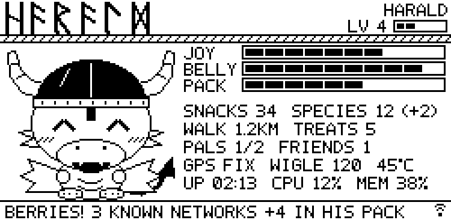
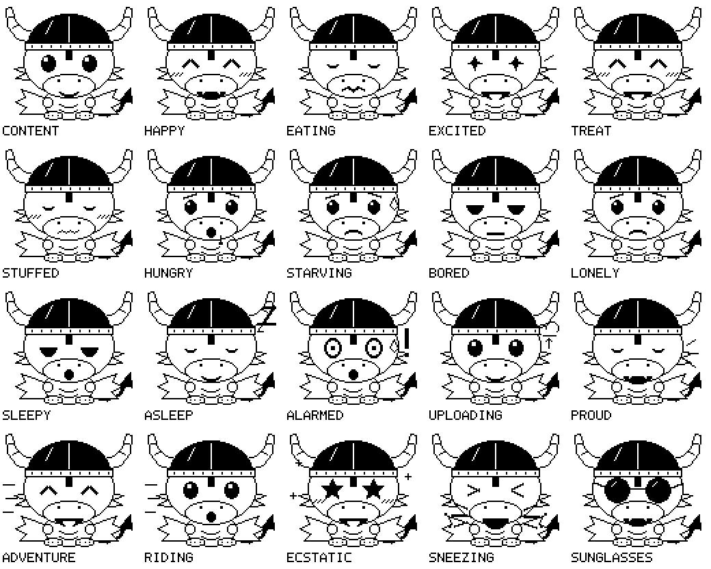
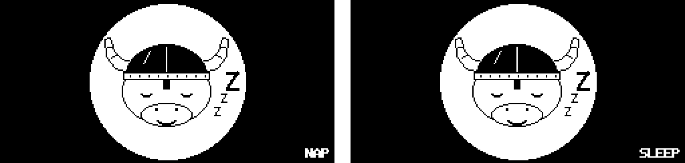

# ᛒᛏ·ᛞᚱᚨᚷᛟᚾ  BT Dragon

**A Bluetooth-eating Viking dragon for a Raspberry Pi Zero 2 W.**



BT Dragon turns a Raspberry Pi Zero 2 W (on its own, or as part of an old Pwnagotchi with its e-ink screen) into a different kind of pocket pet: a cartoon Viking dragon who snacks on the Bluetooth gadgets around you, treats himself to Wi-Fi networks, goes on walks with you (with the use of an external battery), makes friends with other dragons, and engages in a virtual butterfly cultivation hobby. He's called **Harald** unless you rename him in the Den (his control panel), in which case the new name is used everywhere the old one was. The rest of this document assumes the default name. The default artwork and in-app language is purposely gender-neutral so your dragon can rock any name of choice.

Optional GPS integration unlocks the ability to "conquer" squares on a real-world map by traveling through them with Harald, "visiting" real public-access historic landmarks and green spaces (major parks, etc.) by passing near them, and participating in the WiGLE.net wireless access point discovery "point-scoring" leaderboards and rankings. If connected to the sensors of a user's smartphone, Harald can pass on interesting information about the types and numbers of navigational satellites he can see (using the phone's GPS) which are added to his "star" collection, changes in weather (detected via the phone's air pressure sensor), and other features. There is even an included way to connect him to an old 2nd Gen Echo Dot that has been unlocked and rooted, giving the user a way to ask Harald some basic questions and issue certain commands, either by pressing the action button or by using a hands-free wake word (with lots of room for additional development).

**Why Harald?** He's named after **Harald "Bluetooth" Gormsson**, a Viking king of Denmark who died around 986. He's remembered for uniting Denmark's tribes under one crown, for bringing Christianity to the Danes, and for the great runestone he raised at Jelling, which Danes still call their country's birth certificate. Nobody knows for sure where his nickname came from: perhaps a dead, dark tooth, or an older word meaning "dark chieftain". In 1997, engineers from Intel, Ericsson and Nokia were looking for a working name for a new short-range radio standard that would unite phones and computers, the way Harald had united the Danes. They called it Bluetooth, and the name stuck. The Bluetooth logo is Harald's initials in runes: ᚼ (H) and ᛒ (B), joined together. Thus, this Bluetooth-eating dragon is Viking-themed and named Harald in honor of that legacy.

## Latest Updates as of October 17, 2026 at 13:08 PM BST

**Known Issues**
- GPS wobble is erroneously assigning minor "riding" distances while indoors. A fix is in the works but not yet implemented.

**Added**

- **Friend beacon tick box (untested):** **Dragon friends** in the Den has a tick box to switch the friend beacon off and on.
- **Rations (feasts confirmed to reward, lands and books untested):** every feast and every land claimed earns you a ration. Harald can't touch them. Press **Give Ration** in the Den and his pack is filled completely, for days when you're stuck indoors and can't take him out. They can be stockpiled. Finished books award packs of rations based on book length (see "the library")
- **The library: Harald's Hoard (untested):** a book tracker imported from the project author's other project (Bookworm), for Harald's favorite treasure: knowledge. Logging your reading brings him joy, and finishing a book earns rations (10, 20 or 30, by its length), library points and titles. **Open the Library** for your books, the Open Library search, Want To Read and Completed Books.
- **The e-reader (untested):** Bookworm's EPUB reader, with automatic tracking. Add DRM-free EPUBs to the library's **E-book shelf**: they're kept on the Pi, so your place and what you've read follow you between your phone and computer. Pages you read can be logged for joy, like any reading. EPUBs aren't included in backups.
- **Achievements (testing ongoing):** milestones for how many of each thing Harald has collected, in five stages from Copper to Platinum, each an oval runestone carved with its category's rune. The Den shows the latest; **Open Achievements** shows them all, including Bookworm's own for the Butterfly Garden.
- **Northern lights alerts:** Harald tells you when the aurora might be visible from the Lair on dark evenings.
- **Future Development Options:** a plan for optional child rescue and missing person alerts (the US, Canada, the UK and Ireland), with what's been decided so far.
- **The Gadget Journal:** every type of gadget as a collection, with rarities, cards, points and titles.
- **The Star Chart:** navigation satellite constellations as a collection, with each one's rarity worked out for where the Lair is.
- **Growing up (untested):** Harald's belly, joy and pack hold a little more at each level. An option in Developer Tools lets the Butterfly Garden's needs grow too.
- **Sharing with the garden:** when Harald's belly is full, snacks and feasts go straight to the Butterfly Garden.
- **Gentler on the memory card:** changes are saved together every 10 minutes, and the system log is kept in memory.
- **Mobile Wi-Fi (car treats tested; phone hotspots and keeping them off WiGLE untested):** networks that travel (cars, dashcams, buses, trains, phone hotspots and pocket routers) are a smaller treat of their own, grow no berries, and are never uploaded to WiGLE.
- **New defaults from a day in a big city:** joy drains faster and everyday snacks and treats lift it less, so joy means something at home; open and office networks give less XP.
- **The offline map:** once a day, Harald fetches the map around the lands he's claimed, so the map page still shows streets with no mobile signal.
- **Features In Development and Future Development Options:** two new sections at the end of this README.
- **In development:** a password for the Den, and reaching the Den from anywhere with Tailscale.

**Fixed**

- **Butterfly Garden messages:** a species whose name starts with "The" (The Footballer, a hoverfly) is now "the Footballer larva" and "a Footballer", not "The The Footballer", and "an" comes before a vowel ("an Elephant Hawk-moth").
- **Echo Dot recovery (testing in progress):**
  - Clearer messages when a rescue doesn't work.
  - Fewer pointless rescue attempts.
  - The Dot's ears keep working while its debug link is stuck, and try to repair it.
  - The Dot's open setup network is now locked and closed once Harald is back in (tested).
- **The Star Chart's own Den section,** so it's easier to find: satellites seen by constellation, and the button to the full collection.
- **The Butterfly Garden's pace (testing in progress):** a pupa no longer eats; it takes 24 hours, and the adult emerges by itself.
- **Buses and trams (untested change):** no longer counted as walking, running or cycling while they pull away, slow down or crawl in traffic.
- **Alexa-ready headphones and speakers:** filed under their own names instead of as an Amazon Echo.
- **Installing:** a VPN on your computer is confirmed to stop it from finding the Pi by name (`.local`); the README now says so, with the exact error.
- **Raspberry Pi 5:** BT Dragon is confirmed to install and run unchanged on a Pi 5 (64-bit Raspberry Pi OS, no screen). This was tested because the project author needed to see how two dragons would interact, but only has one RPiZ2W (would get another but there are prohibitive supply issues currently) so therefore attempted a test on their RPi5. It works, so it is worth reporting for other users to know they can try BT Dragon on alternate RPi hardware if that's all they have.
- **Friend beacon (untested change):** a new mood, level-up or rename no longer knocks a dragon's friend beacon off the air (before, two dragons often only saw each other after a restart); a new mood alone is re-announced at most every 10 minutes.
- **Friend beacon on a Raspberry Pi 5 (untested on a real Pi):** a Pi 5 dragon could hear other dragons but never got its own beacon on the air, so they couldn't hear it. A beacon goes out from a throwaway random Bluetooth address, and the Pi 5's radio refuses to take a new address while it's scanning, which a dragon always is. Scanning now pauses for a second or two while the beacon goes up. If it still fails, the log says so three times, then once every half hour, instead of every minute.
- **Growing up, stage by stage (untested):** baby (levels 1–4), child (5–9), teen (10–19) and adult (20+), shown in the Den. The map (lands, famous places, green spaces) and the Star Chart open at level 5, when a dragon becomes a child, like the Butterfly Garden, with an "Unlock now (prototype testing)" box; and a feast is 5 XP (it was 20), so a newborn dragon no longer reaches level 4 in its first minute.
- **"Famished" instead of "starving"** for an empty belly, a gentler word, and his hungriest everyday message now fits the screen.
- **One Dot, one dragon (untested):** a second dragon on the same hotspot leaves an Echo Dot alone while another dragon is using it.
- **README:** the setup stages are now "Tiers" (Tier 1: The basics ... Tier 4: A voice and ears), so they're never mixed up with your dragon's level; and a new section, *Already have a Pwnagotchi card?*, on installing over a Pwnagotchi card and checking its system is new enough (64-bit or 32-bit).
- **Folding Den sections:** every section below Harald's meters now folds away: tap its heading (or press Enter on it). Each heading has the same ▾ / ▸ on its left as the Butterfly Garden's. Each one stays as you left it on that phone or computer, and any section added in future folds the same way.
- **Gender-neutral titles:** to mesh with allowance for non-masculine names, titles with a masculine word were renamed: **Hoard-Ruler of the Endless Library** (the library; it was Hoard-King), and in Conquests **Saga-Sung Sea-Sovereign** (Sea-King), **Wyrm-Ruler of the Wilds** (Wyrm-King) and **Hoard-Hunting Herald** (Huscarl, Old Norse for "house-man"). Titles that name a rank traditionally held by men, but aren't a masculine word, keep their names (Thane, Jarl). Titles already earned are kept.
- **Fly on the Wall:** the Butterfly Garden's achievement for raising every British fly (it was Lord of the Flies).
- **The Den's layout:** menus that were too squeezed or too wide were tidied, and the home zone setting moved to the WiGLE section.

**Notes**

- Current space used on the prototype Harald's microSD card is 78.33 MB on bootfs partition and 3.41 GB on rootfs partition.

## Previous Updates on October 15, 2026

**Added**

- **British, American or Canadian English** for Harald's screen and the Den.
- **Color Blindness Mode** for the Den and all its pages.
- **Sleep screens** for naps and sleep, replaceable with your own pictures.
- **Conquest points and titles** for everything claimed out in the world.
- **The Butterfly Garden's Collection and Habitats pages,** with collected insects scoring points.
- **Privacy:** a home zone where wardriving sightings are never recorded, a 90-day limit on sightings, and a dragon ID that changes every day.

**Fixed**

- **Security:** other websites can no longer reach the Den or the control link, the map's code is pinned, and the system log no longer records what was said, where Harald has been, or other people's device addresses.
- **Developer Tools:** changes now take effect at once.
- **Typed questions:** answered through the phone when the Dot is away, and nothing piles up for an absent Dot.
- **Fixes from testing:** a nap's catch-up time, \*YAWN\* being read out as "asterisk", the "safe to unplug" picture being drawn over, and poor air quality at the Lair not being announced.

> **Prototype release.** Everything here is being tested on the author's own hardware, but it hasn't been tried on many setups yet. Expect rough edges, and please open an issue when you find one.
>
> **Placeholder art.** Harald's current pixel art is an AI-generated placeholder, made only so the prototype could be designed and tuned. It will be replaced with the author's own original, hand-drawn artwork before the first release. The Den also allows an individual user to easily upload their own artwork or artwork they have permission to use. AI-generated placeholder art is also currently used throughout the insect collection for the prototype testing phase. The insect art is purposely general and makes no effort to replicate individual species; it consists of a simple mock-up with the word "TEMP" in large letters across it. It is the author's intention to replace all of the insect art with human art that reflects each individual species, though this process will likely take some time.
>
> ### 🤖 AI disclaimer
> **The project author's personal ethics on AI use and the author's intentions.**
> The project author's educational backgrounds are in traditional art, biology, and psychology - not computer science, therefore AI was heavily used to code this project. The project author is aware of the risks and environmental consequences associated with AI use, therefore their personal stance on anything they create with mostly or wholly AI-generated code is that the code must be free and open source (FOSS) to all and the end product must benefit human users in a long-term, tangible manner that also respects user's privacy at every turn. Harald was created as a way to re-use old hardware (reducing potential e-waste) inexpensively and in a fun way that promotes curiosity and education about the invisible signals that surround us. Harald also encourages the physical activity of the user towards finding real new and novel signals to "feed" their dragon (which a GPS link enhances by adding "lands" to conquer by real-world exploration with Harald and the WiGLE account upload feature). There is also an insect collection feature which teaches the user (using verified facts from educational public bodies and charities) about the insects present in their country. It is the project author's sincere hope that their intentions behind the creation of Harald are understood and respected even if their choice to use AI for this project is ultimately not.
>
> **BT Dragon was written with Claude, Anthropic's AI assistant.** Claude wrote essentially all of the code, the dragon's current placeholder pixel art and the original documentation, working from detailed conversations with the project's author over multiple sessions. This document was originally written by Claude but then heavily reviewed and edited by the project author for content and accuracy before being uploaded to GitHub.
>
>The author came up with the idea for Harald and directed the work: the features, how Harald's food, joy and leveling should feel, the privacy rules (passive only, no following other people's devices), and every design decision along the way. The author also tested it on real hardware, found the bugs, and experimented with Harald to tune him. Bugs and ideas for improvement were reported to Claude, who performed troubleshooting and bugfixing in the code itself. Claude's own testing was limited to simulations and automated checks; anything marked "tested" in this README was genuinely tested by the author on their real devices (which are named).
>
> **If you're uncomfortable using AI-assisted code for any reason, please don't use this program.** That is your choice, it is perfectly reasonable, and this disclaimer is here so you can make it before downloading (if you're reading this on GitHub) or installing anything. That being said, please respect that the project author has been completely open and honest about the contents of this disclaimer and the fact of its inclusion, especially in a world where more and more individuals are attempting to pass off partially or completely AI-generated work as their own, either through direct deceit or by omission of fact.
>
>If you're still interested in learning about Harald after all that, let's move on...

---

## Contents

This guide grows with your setup. Start with the bare minimum, a Pi on your home network, and add the next tier only when you want what it brings.

| Tier | You add | He gains |
|---|---|---|
| [1. The basics](#tier-1-the-basics) | A Raspberry Pi Zero 2 W, a microSD card, your home Wi-Fi and a computer | Bluetooth snacks, Wi-Fi treats, types of gadget, friends, finding your own gadgets, tracker warnings, the moon, a shopping list and calendar, kitchen timers, typed questions, the weather and local weather news from his Lair, a Butterfly Garden (from level 5), a library of the books you read, achievements, the Den |
| [2. Out and about](#tier-2-out-and-about) | Your smartphone's hotspot and a USB power bank | Walks together: more to eat, dragons to meet, the Den in your pocket. Optionally, much of Tier 3 without phone apps: a USB GPS receiver, or claiming land by Wi-Fi |
| [3. Your phone's senses](#tier-3-your-phones-senses) | An Android phone sharing its sensors | Walks tracked and logged, wardriving, conquering the map, landmarks, parks, stars (these from dragon level 5), weather, sunshine, his voice through your phone |
| [4. A voice and ears](#tier-4-a-voice-and-ears-echo-dot) | A rooted Echo Dot (2nd generation) | Spoken news, a mood ring, using your own voice to ask questions and set timers, verbally add to your calendar and shopping list, the "Hey dragon" wake word for hands-free use |

Then:

- [Privacy: what stays where](#privacy-what-stays-where)
- [Responsible use](#responsible-use)
- [How it works](#how-it-works)
- [Features In Development](#features-in-development)
- [Future Development Options](#future-development-options)
- [License](#license)

---

## Tier 1: The basics

A Raspberry Pi Zero 2 W on your home Wi-Fi, with no screen, no phone and nothing else. You see him and look after him through the **Den**, an HTML page he serves directly to your computer's browser.

### What he does at this tier

- **Snacks and treats.** He eats the Bluetooth gadgets around him (snacks) and treats himself to Wi-Fi networks he hasn't seen before. Networks he already knows regrow like berry bushes.
- **Types.** Every type of gadget he eats ("AirPods Pro", "JBL speaker") goes in his life list. A new type is a feast. (On his screen, **TYPES** is how many he knows. They used to be called "species", but now that the Butterfly Garden has real insect species, gadgets are "types".)
- **The Gadget Journal (untested).** **Open the Gadget Journal**, under *Life list* in the Den, opens his types as a collection, like the Butterfly Garden's: 33 kinds of gadget he can recognize, in seven groups (phones and computers, listening, wearables and fitness, trackers, beacons, around the home, and mysteries), each with a rarity (**Common**, **Uncommon** or **Rare**: how often one turns up on an ordinary walk through a town; a judgement, not a measurement). The ones he hasn't found yet are there too, dimmed, as something to look out for. Tap any of them for its card: what it is, how its signal works (which Bluetooth service or company number gives it away), a *Did you know?*, when he first ate one and how often, and sources to read more. AirPods list each model he's found. Everything else he's eaten is under **Field finds**: gadgets named after their maker's company number, and gadgets that broadcast their own name.
  **Gadget Journal points (untested)** come with every new type: **20** for a Common one, **60** Uncommon, **150** Rare, and **10** for each field find, shown under *Life list* in the Den, at the top of the Journal, and in the diary (**"New type: Tile tracker +60 Gadget Journal points."**). The titles, each announced on his screen the first time it's reached: **Nibbling Newling** (to start), **Byte-Biting Bairn** (100), **Gadget-Gnawing Glutton** (250), **Signal-Sniffing Sleuth** (500), **Beacon-Bolting Bard** (800), **Tracker-Tasting Thane** (1,200), **Rune-Reading Loremaster** (1,700), **Saga-Scribing Skald** (2,300), **Keeper of the Codex Draconis** (3,000) and **Huginn's Equal** (4,000: Huginn, "thought", is one of the god Odin's two ravens, who fly over the world each day and bring him back news of everything they see). As with Conquest points, the score is counted from his life list, so types eaten before points existed count too.
- **Moods and meters.** Joy, belly and pack, his level and XP, and a face that shows how he feels (see [his meters](#his-meters) below).
- **Dragon friends.** He meets other BT Dragons (and recognizes Pwnagotchis) by Bluetooth.
- **Finding your own gadgets.** Mark your headphones, speakers and so on as **pals**, and the Den's **Find** meter plays "hot and cold" with them.
- **Unknown-tracker warning.** If an AirTag-style tracker away from its owner keeps showing up with him, he raises the alarm.
- **A diary** of everything he did, kept on the Pi, downloadable as spreadsheet files.
- **The moon.** He knows the moon phases without having to check anything online besides the current date and time: they're worked out on the Pi from the date, with the formulas astronomers use. On the day of each new moon, first quarter, full moon and last quarter he gets a burst of joy (the full moon is the biggest) and announces it, Norse style: in the old myths the moon is the god Máni, chased across the sky by the wolf Hati (**"MANI SHINES! FULL MOON TONIGHT"**). The Den shows tonight's moon and when the next phases are.

- **A shopping list and a calendar.** Each has its own page in the Den (*Shopping list and calendar*). A calendar reminder shows on his screen (and the Den's copy of it) only as **"REMINDER: EVENT IN 1 HOUR!"**, so anyone glancing at him can't read your plans. Asking about them out loud needs ears (Tier 4), but adding things, ticking them off and reminders all work now.
- **Ask Harald: typed questions and kitchen timers.** In the Den's **Ask Harald** section, type a question and his answer appears underneath: the time here or in a big city, the date, the shopping list, what's on the calendar, or the weather. "Set a pasta timer for twelve minutes" works too: when it ends, his screen says **TIMER DONE!** and the Den shows a **Stop** button. If the answer is short enough for his screen, it shows there too, as **"ANSWER: IT'S 14°C (57°F) AT THE LAIR"**; a longer one shows **"ANSWER: A LONG RESPONSE. CHECK THE DEN."** (that's for the screen only: if he has a voice, he says the whole answer as usual). He only knows a set range of questions (the full list is under [Asking him questions](#what-he-gains-1) in Tier 4), and his answers don't come from a search engine: for anything else, use a real search engine (DuckDuckGo, for example) or an assistant that uses one (Hey Google, Siri, Alexa and so on).
- **Harald's Lair: the weather at home.** In the Den's **Harald's Lair** section, enter a place (a city, "city, state", or a zip or postcode) and its country. That's home, as far as the weather is concerned: ask him "What's the temperature at home?", or about the humidity, air pressure, pollen count (Europe only), UV index, air quality, sunrise or sunset there. The country matters because there's more than one London and Toronto in the world. He keeps the Lair only to within about 10 km, and a postcode is cut down to its area before it's looked up, so your full postcode never leaves the Pi (how, exactly, is in [the privacy section](#the-lair-and-your-postcode)). Both need the internet.
- **Local announcements** (in the Lair section). While he's online, he keeps an eye on the weather at home, each kind of news at its own time so they never pile up:
  - **on the hour:** how warm it is, **"It's 14°C (57°F) outside at the Lair."** on the screen, and out loud **"At the Lair, the current temperature is 14 degrees Celsius, that's 57 Fahrenheit."** (the place comes first, so there's time to start listening before the number; no joy for this one, and not during quiet hours) **Note: The temperature displayed on the dragon's screen above the memory usage percentage is not the outside temperature; it is the current temperature of the Pi itself**;
  - **a quarter past:** when the air pressure there is falling or rising fast, **"There's a storm coming at the Lair!"** or **"The weather is changing at the Lair!"**, with the same joy as when he feels a storm himself through your phone's barometer (Tier 3);
  - **half past:** when the pollen count is high, he sneezes: **"Achoo! The grass pollen is high at the Lair."**, or, if it was already high and has gone up since the hour before, **"Achoo! The grass pollen is higher at the Lair! It's very high now."** (Europe only: see [pollen outside Europe](#pollen-outside-europe));
  - **a quarter to:** when the UV index is high, he puts his sunglasses on: **"Sunglasses on! The UV index at the Lair is 7, that's high."** (or **"…is higher! It's 8 now"**);
  - **half past, too:** when the air quality is poor or worse, he sneezes again: **"The air quality at the Lair is poor, with a European air quality index of 65."** (in the US, from "unhealthy for sensitive groups" on the US index);
  - **sunrise and sunset**, as they happen, with a little joy: **"The sun is rising at the Lair!"** on the screen, and out loud **"At the Lair, it is 7:12 in the morning and the sun is rising."** (the time at the Lair itself);
  - **the northern lights (untested)**, on dark evenings at ten to the hour: whether they might be seen from the Lair tonight, **"Northern lights alert! The northern lights might be seen low in the northern sky at the Lair tonight. Look north, away from street lights."**, with his excited face and a burst of joy, once a night (again only if the chance gets better). [How it works](#the-northern-lights) is below;
  - **official weather warnings**, checked every 15 minutes (at 5, 20, 35 and 50 past) and announced once each, with his alarmed face: **"AMBER WARNING: WIND AT THE LAIR"**. In the United Kingdom they come from the Met Office, for the Lair's region (worked out from the county; the Den lets you change it if the guess is wrong). In the United States they come from the National Weather Service, for the Lair's forecast zone and county. Other countries aren't covered yet, as each publishes its warnings its own way. Ask him **"Are there any weather warnings at home?"** for the ones in force.

  High pollen and high UV show on his screen every hour they're high. **What he says out loud is up to you**: if he has a voice (the phone, or the Dot at Tier 4), the Den's *Voice and light ring* section has **Weather information: Lair**, with a tick box for each kind of news (Temperature, Storm or change, Weather warnings, Poor air quality, High pollen, High UV, Sunrise/sunset, Northern lights). A ticked box is said even in *Big moments* mode. Poor air quality, High pollen and High UV each have a choice of **Increased readings only** (the default: said when the reading goes up, so a long sunny day isn't a reminder every hour) or **All high readings**. There's a matching **Weather information: Phone sensors** for the storms and sunshine his phone's barometer and light sensor notice (Tier 3). Untick anything and he still shows it on his screen, just quietly.

**Confirmed so far in testing:** setting the Lair, sunset, official warnings (announced once, with the alarmed face) and the Den's Lair section are confirmed. Storms, high pollen, high UV and poor air quality haven't happened yet to test, and sunrise hasn't been watched for.

#### The northern lights

*Untested: the forecast can't be fetched from where this was written, so it's checked against made-up forecasts in both of NOAA's layouts.*

**What makes them.** The Sun keeps blowing out charged particles (the solar wind). When a burst of it hits the Earth's magnetic field hard, the field is shaken, and particles pour down along it into the air 100 to 300 km up, around a ring over each magnetic pole (the *auroral oval*). They make oxygen glow green (and red, higher up) and nitrogen purple and blue. The harder the shake, the wider the ring spreads, and the further from the pole the lights reach.

**The forecast.** How hard the field is being shaken is the **Kp index**, from 0 (calm) to 9 (an extreme storm), measured by magnetometers around the world for each 3-hour stretch. On dark evenings, at ten to the hour, Harald downloads NOAA's Space Weather Prediction Center's public Kp file (the past week, measured, and the next three days, forecast). Nothing about you or the Lair is sent: it's the same file anyone can open.

**Where you are counts magnetically.** Picture the Earth's field as a bar magnet inside it. The magnet is tilted, with its north end pointing up through northern Canada, and it sits about 590 km off the Earth's centre, towards the western Pacific. Harald works both out from the International Geomagnetic Reference Field (the model of the field geophysicists agree on every five years), and measures the Lair's latitude from that magnet instead of the Earth's axis. It's why the lights reach so much further south in North America: Toronto, at 43.7°N, is about as far from the magnetic pole as London, at 51.5°N, is. NOAA's table says how far from the magnetic pole the oval's edge reaches at each Kp; aurora is high up, so you can see it low over the horizon from about 4° of latitude further away (roughly 450 km), and a phone camera on a long exposure picks up a fainter glow from about 2° further still.

So the Lair section of the Den shows, for the Lair, the Kp needed for each (for London: a phone camera from about Kp 5, low in the north by eye from about 6, overhead from about 8), and the latest Kp when he's checked. On a dark evening when the forecast for now or the next three hours reaches one of them, he says so: **"A phone camera might catch the northern lights…"**, **"…might be seen low in the northern sky…"**, or **"…could be overhead at the Lair tonight! Go outside and look up."** Once a night, and again only if the chance gets better. Below the equator, they're the southern lights, and he says to look south. These are rules of thumb, good to a degree or two: the forecast is for 3-hour stretches while the lights come and go in minutes, and clouds and street lights hide everything. The joy is **Northern lights possible at the Lair** in **Developer Tools**.
  
- **Language (testing is ongoing): British, American or Canadian English.** Also in the Lair section. Everything written on his screen, in the Den and on its other pages (the map, the shopping list, the calendar, the artwork page, the Garden Collection) follows the English you choose: "metres" or "meters", "colour" or "color", "grey" or "gray", "organise" or "organize", "autumn" or "fall". Canadian English keeps British spellings with "-ize" endings and North American words. The rules come from Bookworm, so Harald and the Butterfly Garden spell alike. **Language matches Lair location automatically** is ticked to start with: a Lair in the US gets American English, Canada Canadian, and the UK or Ireland British. With no Lair, or a Lair elsewhere, it's the Pi's own country (the Wi-Fi country you chose in Raspberry Pi Imager), and British English if that isn't one of these. Untick it to choose for yourself; for example, an American living in the UK can keep American English with a UK Lair. When you move the Lair to the UK, Ireland, the US or Canada, a small question asks whether to change the language and the Butterfly Garden to match: either, both or neither. Not changed: what he says out loud, the names of networks, gadgets and places, your own list items and calendar events, the diary, the README and the code. Numbers stay metric either way (with °F next to °C, as before).
- **Optional: his voice, through an Android phone.** It needs none of the phone's sensors, only the phone on the same Wi-Fi as him: see [His voice through your phone](#his-voice-through-your-phone-partly-tested).

What he can't do yet: anything that needs to know where he is (walks, wardriving, the map). That's Tier 3, or Tier 2 with a [USB GPS receiver](#optional-a-usb-gps-receiver-untested) or [finding him by Wi-Fi](#no-gps-at-all-finding-him-by-wi-fi-untested).

### What you need

- A **Raspberry Pi Zero 2 W** (the "2" matters: the older Pi Zero W is much slower and untested).
- A **microSD card of 8 GB or more.** Everything installed, including the extras for the higher tiers, takes roughly 4 GB. The tested card is 16 GB, which leaves plenty of room. If your computer has no card slot, you'll also need a USB card reader.
- A **micro-USB power supply**, 5 V and at least 2.5 A (an official Raspberry Pi supply is the safe choice).
- Your **home Wi-Fi**: a private network that you control, broadcasting on **2.4 GHz**. The Pi Zero 2 W's radio can't see 5 GHz networks. Most home routers broadcast both, often under the same name, which works fine. **Note from testing:** if you are using a phone hotspot as your home wi-fi for Harald, ensure that the security is set to WPA2 only. A test with a "WPA3/WPA2" combination prevented the Pi from connecting.
- A **computer** (Windows, macOS or Linux) on the same home network.

### Before installing or updating: pause your VPN

If your computer (or your router) runs a VPN, pause it for the install and for every update. A VPN can send your computer's traffic somewhere else, so it can't find the Pi on your home network, and it can block or slow down the Pi's downloads. Turn it back on when you're done.

**Tested:** with a VPN running on a Windows computer, `ssh yourname@bt-dragon.local` failed with *"Could not resolve hostname bt-dragon.local: No such host is known"*; pausing the VPN fixed it straight away. Names ending in `.local` are found by asking the whole local network ("who is bt-dragon?"), and a VPN takes over the computer's network settings, so the question never reaches the Pi. If you see that error, pause the VPN before trying anything else.

### Already have a Pwnagotchi card?

**The recommended way is a fresh card**, as in the steps below: your Pwnagotchi card stays exactly as it is, and you swap cards to switch between the two.

You *can* skip writing a new system and install BT Dragon on top of the card your Pwnagotchi already runs from (go straight to Step 2). **This is untested**, and only works if that card's system is new enough. Pwnagotchi images are built on Raspberry Pi OS, but there are several: the original Pwnagotchi (version 1.5 and older) is a 32-bit system from 2021 (Debian 10, "buster"), far too old for BT Dragon; newer community images (Pwnagotchi 2.x) come in 32-bit and 64-bit versions. To check yours, log in to the Pwnagotchi over SSH and run:

```
uname -m
grep VERSION_CODENAME /etc/os-release
```

- `uname -m` says **aarch64** on a 64-bit system (what BT Dragon is tested on), or **armv7l** or **armv6l** on a 32-bit one (untested).
- The second line says **bookworm** (Debian 12) or **trixie** (Debian 13) on a system new enough. **buster** or **bullseye** is too old: use a fresh card.

If you go ahead, the installer switches Pwnagotchi's own programs off (without deleting them) so they don't fight over the screen and the radio. Pwnagotchi also sets up the Wi-Fi and Bluetooth in its own way (its Wi-Fi listens in "monitor mode", and it can tether to your phone over Bluetooth), which may still get in the way of BT Dragon joining your Wi-Fi. If anything misbehaves, a fresh card is the cure.

### Install, step by step

> **Testing so far:** updating an existing install with `update-bt-dragon.bat` (Windows) is confirmed. A fresh install from a blank card hasn't been re-run since this version's changes, and `update-bt-dragon.sh` (macOS and Linux) hasn't been tested yet.

You don't need any Linux experience. You'll copy files onto the card, plug in the Pi, and type two commands.

**Step 1: Write Raspberry Pi OS to the card.**

1. On your computer, install **Raspberry Pi Imager** from [raspberrypi.com/software](https://www.raspberrypi.com/software/) and open it.
2. **Device:** Raspberry Pi Zero 2 W.
3. **Operating system:** Raspberry Pi OS (other) → **Raspberry Pi OS Lite (64-bit)**. ("Lite" means no desktop, which a pet doesn't need.)
4. **Storage:** your microSD card. Everything on the card will be erased.
5. When it asks about OS customization, choose **Edit settings**:
   - **Hostname:** `bt-dragon` (the rest of this guide assumes this name).
   - **Username and password:** pick your own and write them down. You'll need them to log in to the Pi.
   - **Wireless LAN:** your home Wi-Fi's name and password, and your country.
   - **Locale settings:** your time zone and keyboard layout.
   - **Services** tab: tick **Enable SSH** and **Use password authentication**.
6. Save, then **Write**. It takes a few minutes.

**Step 2: Copy BT Dragon onto the card.**

1. When writing finishes, take the card out of your computer and put it back in. A drive called **bootfs** appears.
2. Download this project (the green **Code** button on GitHub → **Download ZIP**) and extract it.
3. Copy the whole `pi` folder onto **bootfs** and rename the copy to `bt-dragon`. Check: there should now be a file at `bootfs/bt-dragon/install.sh`.
4. Also copy `pi/bt-dragon.toml` to the top level of **bootfs** (next to the `bt-dragon` folder, not inside it). This is his settings file.

**Step 3: Fill in the settings file.**

Open `bt-dragon.toml` on **bootfs** in a plain text editor (Notepad on Windows, TextEdit on macOS). Under `[home_wifi]`, put your home Wi-Fi's name and password between the quotes:

```
ssid = "YourNetworkName"
password = "YourNetworkPassword"
```

On his first start, he replaces the password with a scrambled key, so it isn't left in the file as plain text. Everything else in the file can stay as it is; each setting is explained in the file itself. Save, then eject the card.

**Step 4: First start.**

1. Put the card in the Pi and plug the power supply into the port marked **PWR** (the one nearest the end of the board; the middle one is for data).
2. Wait about 3 minutes. The first start is slow, and there's no screen to watch, so be patient.

**Step 5: Log in and install.**

1. On your computer, open a terminal: on Windows, **PowerShell** (search for it in the Start menu); on macOS, **Terminal**.
2. Type this, using the username you chose in Step 1, and press Enter:
   ```
   ssh yourusername@bt-dragon.local
   ```
   - If it asks whether to continue connecting, type `yes`.
   - Type your password when asked. Nothing appears while you type it; that's normal.
   - If `bt-dragon.local` isn't found, find the Pi's IP address in your router's list of connected devices (usually on a page called "Devices", "Attached devices" or "DHCP clients", reached by typing your router's address into a browser), and use it instead, for example `ssh yourusername@192.168.1.42`.
3. Then type:
   ```
   sudo bash /boot/firmware/bt-dragon/install.sh
   ```
   This downloads and installs everything he needs. Expect 10 to 20 minutes on a Pi Zero (longer on a slow connection). When it's done, the Pi restarts by itself, and about a minute later Harald is awake.

**Step 6: Say hello.** Open the Den (next section).

### The Den: his local HTML page

Open a browser on your computer and go to:

**http://bt-dragon.local:8080**

If that doesn't load, use the Pi's IP address instead (the same one as in Step 5), followed by `:8080`, for example `http://192.168.1.42:8080`. Bookmark it.

Without a screen on the Pi, the Den *is* how you see him: a live copy of his screen sits at the top, with *No e-ink screen: this is his screen* underneath. The screen display provides a few system metrics, such as the current temperature of the Pi itself, the "up" time, and the CPU and memory usage percentages. The Den also gives you far more than any screen could:

- **His meters and today's news:** joy, belly, pack, XP, what he's eaten, recent treats, his life list and his diary (also downloadable as daily spreadsheet files).
- **Gadgets nearby and pals:** tap **It's mine** on your own headphones or speakers, then use **Find my pals** to track them down. **Search for my gadgets** finds classic-Bluetooth gadgets in pairing mode.
- **Tracker alerts**, with a button to dismiss them.
- **Dragon friends** he's met.
- **Care and Accessibility:** rename him, restart him, **Nap** (as good as switched off, but wakeable from the Den), **Put to sleep** (safe to unplug), **Artwork** (see below), the **Sleep screen** tick boxes, and **Color Blindness Mode** (both below).
- **Backup:** download a small file with everything that's his, and restore it later.
- **Developer Tools:** every number that drives him (how fast he gets hungry, how much each snack is worth...), adjustable while he runs.

> **The Den lives on the Pi, not on the internet.** The Den and its pages (the shopping list, the calendar, the map and the artwork page) only open while your computer or phone can reach the Pi over the same network. They aren't an online service or an app on your phone. For example, you can only tick things off the shopping list while you shop if Harald is in your bag, on your phone's hotspot (Tier 2). At home with him, you can read it out or write it down before you go.

**The order of the Den.** Below his meters, the Den starts with what a dragon at Tiers 1 and 2 (no GPS, no Echo Dot) does most: **Find my pals**, **Dragon friends**, **Gadgets nearby**, **Recent treats**, his **Life list** and **Diary**, then looking after him: **Network**, **Care and Accessibility**, **Backup** and **Developer Tools**. After that come the parts that are still useful without GPS or a Dot (**The moon**, the **Butterfly Garden**, then the **Shopping list and calendar**, **Ask Harald** for typed questions and kitchen timers, **Harald's Lair** for the weather at home, then **Voice and light ring**), and last the ones that need GPS (**Adventures today**, **Conquests**, **WiGLE**). **Voice and light ring** is folded away until you open it. To change the order, press **Arrange the den** at the bottom of the page and move sections up or down; **Back to the usual order** undoes it. The order is remembered by each phone or computer's browser, so your phone and your computer can each have their own.

**Folding sections (untested).** Every section below his meters folds away to just its heading: tap the heading (or press Enter on it) to fold or unfold it. A ▾ before the heading means it's open, ▸ that it's folded. Each section stays as you left it on that phone or computer. His meters, alerts and the nap notice never fold.

**Always put him to sleep before unplugging.** Use **Put to sleep** in the Den and wait about 30 seconds (with a screen: until the **SLEEP** screen appears, or *SAFE TO UNPLUG* if you've turned the sleep screen off), then pull the plug. Cutting the power while the Pi is writing to the card can corrupt it.

### Keep him on a private network

> ⚠️ **The Den has no password.** Anyone on the same network who knows (or guesses) his address can open it and:
> - see your pals (your own gadgets) and their Bluetooth addresses, your diary, and (at higher tiers) the map of everywhere you've taken him, your walks, your calendar and your shopping list
> - **download a backup, which contains your Wi-Fi passwords and WiGLE token**
> - download your wardriving data
> - rename him, put him to sleep, restart him, or change any of his settings
>
> On a network you control (your own home Wi-Fi, your own phone's hotspot), only your own devices are connected, so that's fine. **Never connect him to public or shared Wi-Fi**: cafés, hotels, libraries, school, work or a neighbor's network. Anyone else on those could reach the Den.
>
> Web pages you open on your phone are a different matter: they can't reach him, even though your phone is on his network. See [What's visible on your network](#whats-visible-on-your-network).
>
> With an e-ink screen, a tiny ⚓ anchor appears at the bottom right of his screen whenever a Den page is open anywhere, so you can tell if someone else is looking.

### Optional: an e-ink screen (Pwnagotchi hardware)

If your Pi is part of an old **Pwnagotchi** with a **Waveshare 2.13" e-ink screen**, Harald uses the screen by himself: no setting to change.

| Screen | Status |
|---|---|
| Waveshare 2.13" e-ink **V4** | ✅ Tested. Not yet: your own artwork on the panel, and the faces that need a particular moment (sleepy, sneezing, sunglasses, dazzled) |
| Waveshare 2.13" e-ink **V3** / **V2** | ❓ Supported but untested. Set `model = "V3"` or `"V2"` under `[display]` |
| Other Pwnagotchi screens (Inky, 2.7", etc.) | ❌ Not supported |
| No screen ("headless") | ❓ Supported but untested. Noticed by Harald himself at start-up |

- The version is printed on the back of the screen's circuit board. Pwnagotchi cases usually mount it upside down, so the picture is turned 180° by default; set `rotate = 0` under `[display]` if yours appears upside down.
- **Your Pwnagotchi card stays untouched** if you install BT Dragon on a spare card: swap cards to switch between the two. (Installing on top of your Pwnagotchi card instead: see [Already have a Pwnagotchi card?](#already-have-a-pwnagotchi-card).)
- **The screen flashing black and white now and then is normal, not a fault.** E-ink pixels are tiny capsules of black and white particles, moved by an electric charge. For everyday changes Harald uses a quick *partial* refresh that only nudges the pixels that changed, which is fast and calm but slowly leaves faint "ghosts" of earlier pictures behind. So every 20 minutes (and when he starts, naps or goes to sleep) he does a *full* refresh instead: every pixel is driven through black and white a few times to shake the particles back into place, which is the flash you see. It cleans the screen; nothing is wrong. To change how often, set `full_refresh_minutes` under `[display]` in the settings file (less often means more ghosting in between).
- **How he knows there's no screen:** the panel has a "busy" wire that it holds up while it's working, and a full refresh keeps it busy for a second or two. The Pi's pin for that wire is pulled down inside the Pi, so with nothing attached it never reads busy. If his first refresh "finishes" without the panel ever being busy, there's no panel. If the pin reads busy forever instead (a loose connection), every wait gives up after a while (10 s at start-up, 30 s later), so he carries on without the screen instead of freezing. He checks at every start, so a screen added while he's off is used the next time he starts.

### His meters

Harald has separate meters, so he can be **hungry and happy** after a long walk through a quiet park, or **stuffed and bored** after a day at home with the same old devices.

- **JOY** drops when nothing's happening (a full meter lasts about 10 hours). New things, friends and walks raise it; the everyday snacks and treats only a little, so a day at home lets it drift down, and an outing brings it back.
- **BELLY** (food) empties in about 2½ hours with nothing to eat. Bluetooth snacks and Wi-Fi treats fill it.
- **PACK.** Berries and treats he finds while his belly is already full go into his pack (up to 50). When his belly drops to 25%, he eats half of what's in it, never more than fills his belly back up.
- **Rations (untested).** Rations are yours, not his: a bundle of food you earn for every **feast** (a type of gadget he's never eaten before) and every **land** he claims (a new realm comes with its first land, so it earns one too), and by the pack for every book you finish in the [library](#the-library-haralds-hoard-untested). He can't eat them by himself. When you press **Give Ration**, under his pack in the Den, one ration fills his pack completely, however empty it was, and he eats from it in the usual way as he gets hungry. They're for lean times: a day stuck indoors, ill in bed, or snowed in. Feasts grow rarer as his Gadget Journal fills up, and lands only come from going somewhere new, so they're a limited resource, but they can be stockpiled and never go off. The button is greyed out when there are none, when his pack is already full, or while he's napping. Each one given goes in his diary. In Developer Tools (*Food*), you can change how many each feast and each land earns (fractions add up: 0.25 is one ration for every four), set a most that can be stored (0 is no limit, the default), and set the number you have, for testing. Lands claimed while riding in a vehicle earn the same share as their other rewards (*Lands: rewards while riding*, 25% by default).
- **Time switched off counts too.** When he starts up with a correct clock, he works out how long he was off and drops his meters as if he'd been awake with nothing to eat or do. **XP never drops.**

| | What it is | Food | Joy | XP |
|---|---|---|---|---|
| **Snack** | A new arrival: a fixed-address gadget he hasn't eaten today, or one more phone/watch/earbud of a kind than were already around. Phones change their address every ~15 minutes, so he counts heads, not addresses: the phone on your couch is one snack, not four an hour | +2 | +0.02 | +1 |
| **Feast** | A kind of device he has never eaten before (it goes in his life list, and earns Gadget Journal points too) | +12 | +5 | +5 |
| **Treat** | A Wi-Fi network he has never seen before. Food: WPA2 +4, WPA3 and office networks +5, open and WEP +6. XP: WPA2 +5, open +4 (they're everywhere in a city), office +5, WPA3 +8, WEP +15 | +4 to +6 | +0.5 | +4 to +15 |
| **Mobile Wi-Fi** | A network that travels, recognized by its name: a car's, dashcam's, bus's or train's ("Audi_MMI_1234", "CarPlay_1a2b", "stagecoach-wifi": *"VROOM! VEHICLE WI-FI: ..."*), or a phone's hotspot or pocket router ("Sam's iPhone", "AndroidAP1a2b", "VodafoneMobileWiFi-12AB": *"BLEEP! PHONE WI-FI: ..."*). A dragon by a road meets dozens of cars an hour, gone a moment later, and a phone's hotspot goes wherever its owner goes, even if it's somebody's home internet too. No berries (they don't stay put), and never uploaded to WiGLE, which maps where networks *are*. Huawei's and ZTE's own names don't count: they also make the 4G routers that stay at home | +1 | +0.1 | +1 |
| **Berries** | A network he already knows. Like a berry bush, it regrows 1 point per day since he last picked it, up to its full treat value | up to +6 | small | small |
| **Friends** | Meeting a new dragon, a returning friend, spotting one of your own gadgets | | +15 / +8 / +3 | +50 / +10 / 0 |
| *Tier 3:* **Adventure** | Walking or running with him switched on | | +3 per 100 m | +2 per 100 m |
| | Cycling with him | | +1.5 per 100 m | +1 per 100 m |
| | Riding in a car or bus with him | | +1 per km | +1 per km |
| | Finishing a walk of 200 m or more ("You took Harald on an adventure!") | | +8 | +5 |
| *Tier 3:* **Story** | Steps your phone counted while he wasn't with you ("You told Harald about your adventure!") | | +1 per 100 m (max 30) | +1 per 100 m |
| *Tier 3:* **New land** | A square of the map about 250 m across that he's never been to. A whole new realm (about 1 km across) is a big one. A quarter as much while riding in a vehicle | +3 / realm +3 | +4 / realm +10 | +10 / realm +15 |
| *Tier 3:* **Stars** | A navigation satellite he's never seen. His first of a new constellation is a big one | +3 / +6 | +2 / +12 | +5 / +25 |
| | A known satellite rising again | | +1 each | |
| *Tier 3:* **Weather** | A storm coming (pressure falling 3 hPa in 3 hours): the first of the day, or a later one | | +15 / +4 | +5 |
| | Pressure rising fast: "Looks like a weather change soon!" | | +3 | +5 |
| *Tier 3:* **Landmarks** | Coming within about 250 m of a famous place: the first time ever, or again (once per place per day) | | +6 / +2 | +10 / 0 |
| *Tier 3:* **Green spaces** | A park or wood he's never been in; a walk, run or ride in one (once per place per day) | | +5 / +6 | +8 / +5 |
| **Moon** | The day of a full moon, or of a new or quarter moon (worked out on the Pi, no internet needed) | | +12 / +4 | +5 |
| *Tier 3:* **Climbing** | Stairs and hills while you're out walking, running or cycling, measured by your phone's barometer | | +2 per 10 m | +1 per 10 m |
| *Tier 3:* **Sunshine** | "Wow! It's sunny out today!": your phone's light sensor reads 30,000 lux or more for 30 seconds (at most once every 3 hours) | | +3 | |
| **Butterfly Garden** | From level 5: an egg hatching or a larva pupating; an adult emerging (fed by snacks and feasts when his belly is full, and treats and berries when his pack is full too) | | +3 / +10 | +10 for an adult |

Every one of these numbers can be changed while he runs, from **Developer Tools** in the Den. Living somewhere rural with few devices around? Make his belly last longer or make each catch more filling.

**Growing up (untested).** A level 1 dragon is a hatchling: easy to feed and to cheer up, like a real baby. With each level his appetite grows: his belly and his joy hold **5%** more than at level 1 (so 20% more at level 5, 45% more at level 10), up to **twice** level 1's. The food and joy in the table above stay the same, so each snack, treat or cheer fills a smaller share of a bigger dragon, and a full belly still lasts as long (it empties in proportion). His meters still show percentages; the Den adds what his belly holds now (*"holds 120 food"*), and the level-up says so too: **"LEVEL UP! HARALD IS NOW LEVEL 5 · BIGGER APPETITE"**. A bigger dragon carries more, so his **pack** grows by the same amount (60 food at level 5). Nothing jumps when he levels up: his meters keep the same percentage, they just hold more. The **Butterfly Garden**'s needs stay the same at every level, so as he grows, less spare food reaches it and insects take a little longer: more earned. To have the garden's needs grow with his appetite instead, set **Growing up: the Butterfly Garden's needs grow too** to 1 in **Developer Tools → Food** (for larvae from then on). **Growing up: bigger appetite each level** (5%) and **Growing up: at most** (200% of level 1) are there too; set the first to 0 for the same appetite at every level.

**Levels:** level = 1 + √(XP ÷ 50), so level 2 at 50 XP, 3 at 200, 5 at 800 and 10 at 4,050. (**Level curve** in Developer Tools sets the 50.)

**Growing up, stage by stage.** What a dragon can do grows with it, roughly as people do. The Den shows the stage under his meters (*"Growing up: a child (can now claim land...). A teen at level 10."*), and reaching a new one is in his diary and on his screen (**"LEVEL 5! HARALD IS NOW A CHILD!"**).

| Stage | Levels | What it can do |
|---|---|---|
| **Baby** | 1–4 | Eat (snacks, feasts, treats, berries), make friends, find your gadgets, walks and stories |
| **Child** | 5–9 | Also: claim land on the map, find famous places and green spaces, learn the stars (the Star Chart), raise butterflies (the Butterfly Garden) |
| **Teen** | 10–19 | All of that, growing all the while |
| **Adult** | 20 and up | All grown up |

A baby can't claim land, recognize stars or raise butterflies, so a newborn dragon learns its first things (eating, types of gadget, friends) before the map, the stars and the garden open up as rewards. Until then, the Den's **Conquests** and **Star Chart** say when they open; **Unlock now (prototype testing)** under Conquests opens the map and the stars early (the box disappears at level 5). Lands, stars and places already claimed are never taken away. *(Untested: the stages and the level 5 unlock. A newborn dragon used to reach level 4 within a minute: every kind of gadget around was new to it, at 20 XP each. A feast is 5 XP now, since a new type earns Gadget Journal points too.)*

**His face:** joy picks the eyes (happy, content, bored, sad), and his belly can change the mouth (drooling when hungry, a contented wobble when stuffed). Short reactions, like a feast, an adventure or riding with the wind in his face, take over for a moment. A small joy boost gets his **excited** face; a big one (8 joy or more, adjustable) gets his **ecstatic** face, with big starry eyes and sparkles. High pollen or poor air at home makes him **sneeze**, sunshine gets his **sunglasses** on (round ones, so they're never mistaken for a Pwnagotchi's square ones), and a high UV index gets the sunglasses with a startled "oh!" (**dazzled**). His **sleepy** face shows between 1 and 6 in the morning when his joy is under 70.



### Dragon friends

Like Pwnagotchis, dragons make friends. Each BT Dragon sends a small Bluetooth beacon carrying a dragon ID, its name, level and mood. When another dragon comes near, the two meet: a first meeting is a big XP bonus and the newcomer joins his friends list; coming back after half an hour or more is a happy reunion.

**Switching the beacon off (untested).** In the Den, **Dragon friends** has a **Friend beacon** tick box, on to start with. Untick it and the beacon goes off the air straight away: other dragons can't find him, but he still meets the ones that broadcast. Tick it to switch the beacon back on.

To have the beacon **start switched off**, before he ever broadcasts, change the settings file: open `bt-dragon.toml` on the memory card's **bootfs** partition (or over SSH, `sudo nano /boot/firmware/bt-dragon.toml`), find `[friends]` and set:

```toml
[friends]
beacon = false
```

Then restart him (or put the card back in). That's only how it starts: once you've used the tick box in the Den, the tick box decides.

**A new ID every day (untested on a real Pi).** A dragon ID that never changed would let anyone with a Bluetooth scanner recognize Harald, and so you, from one day to the next. So the ID changes at midnight. Each day's ID is worked out on the Pi from a secret that never leaves it: the first 4 bytes of HMAC-SHA256(secret, today's date). HMAC mixes a secret key into a hash, so without the key one day's ID says nothing about the next; they look like unrelated random numbers. With it, the same day always gives the same ID, so restarting him mid-day doesn't make him a stranger. Friends still know each other across days by name: a dragon with a new ID, the same name as one of his friends, and the same level or higher, is that friend (as long as only one friend fits). That means a dragon with an unusual name can still be recognized by anyone listening, because the name is in every beacon; a common name ("Harald") hides in the crowd. The beacon goes out from a throwaway random Bluetooth address that Linux picks, not the Pi's own fixed one. He also recognizes a real **Pwnagotchi** nearby (they all beacon from Wi-Fi address `DE:AD:BE:EF:DE:AD`) and gets excited about his distant cousin.

**Two dragons on one network:** give the second one a different hostname in Raspberry Pi Imager (say `bt-dragon2`), and if you use an Echo Dot (Tier 4), set `enabled = false` under `[dot]` in the second one's settings, or both will try to use it. They'll meet each other as friends.

### The Butterfly Garden (from dragon level 5, testing ongoing)

Once Harald reaches **level 5**, a **Butterfly Garden** opens in the Den. It comes from **Bookworm**, the project author's own (unfinished) reading tracker project, where each book you read raises an insect. Here, instead of pages, the larvae grow on Harald's **spare food**.

- **Spare food (untested change):** what doesn't fit in his belly goes to the garden, shared evenly between the larvae growing there, in two ways. **Snacks and feasts** don't keep, so when his belly is full he shares them with the garden straight away. **Treats and berries** keep, so they go into his PACK first, and only reach the garden once the PACK is full too. The Den's garden section shows his belly and pack, and how much spare food the garden has had today. His screen says so too, at most every 5 minutes (*FED 12 FOOD TO THE BUTTERFLY GARDEN*). So a well-fed dragon feeds the garden whenever there are gadgets about, and three larvae at once each grow at a third of the speed of one.
- **Spots:** one at first, and one more for each level he gains after the garden opens, up to three. The first spot always holds an **egg** (a new one as soon as its adult is collected). Any other spot stays **empty** until you press **Put an egg here** in the Den, both when it first opens and after its adult is collected, so you can raise just one or two at a time if you'd rather (spare food is only shared between spots with an egg or a larva in them). An egg that hasn't hatched can be taken away again (**Leave this spot empty**). The first food that reaches an egg hatches it, and only then is its species chosen.
- **Which species:** Bookworm's own rules. Its rarity is rolled (**Common** 60%, **Uncommon** 30%, **Rare** 10%), and a rarer one needs more food to raise (40, 80 or 120 food). Then it's one you haven't raised yet, with species that are in season this month three times as likely. Every egg starts out as a butterfly; raising butterflies unlocks the other categories one at a time (moths after 2, then bees and wasps, beetles, flies, ants and other insects), as in Bookworm.
- **Growing:** the progress bar is Bookworm's. Each species pupates (a chrysalis, for butterflies) at its own point, worked out from how many days it really spends as a larva and as a pupa, and the adult emerges at 100%. **A pupa eats nothing (untested change):** a larva grows by eating, up to its pupation point; from then on the spare food goes to the others, and the pupa simply takes **24 hours**, its percentage rising steadily to 100%, and the adult emerges by itself (even if Harald was switched off meanwhile: it emerged while he was away). The Den shows *"Pupating · Emerges in 13 h 20 min"*. So however much a busy city feeds the garden, each insect spends a day as a pupa, and with three spots at most, a few insects a day at most. (A species that pupates late in its growth needs more food than one that pupates early.) **Butterfly Garden: hours as a pupa** in Developer Tools → Food changes the 24 hours. Each one is drawn with Bookworm's own art, crawling as it grows, then its pupa gently swaying (Bookworm's hand-drawn artwork where it has some, its placeholder drawings for the rest), and an empty spot shows its egg. Hatching and pupating give him a little joy; an adult emerging is a big joy (his ecstatic face), +10 XP and a line in his diary. Each spot in the Den shows the name, the life stage (Caterpillar, Chrysalis, Butterfly...), the rarity and its progress on the left, with its picture at half size on the right, and underneath, how it's doing and when it last ate (*"Satisfied · Last fed yesterday"*); **tap it** to open its field notes, with the picture full size at the top.
- **Hunger:** as in Bookworm, it's about time going by without food. A larva is **Well fed** for 24 hours after it last ate, **Satisfied** until 48 hours, **Peckish** until 72, then **Hungry** (its picture gets a thought bubble with a leaf) and, from 96 hours (4 days), **Very hungry** (with a "!" too). A female of a social species that goes hungry grows up a worker rather than a queen. Pupae don't eat, so they never get hungry. The garden only gets spare food when Harald's belly and pack are both full, and in a quiet place the trickle of new signals keeps him fed but rarely overflowing: it's the burst of new signals on a walk, a run, a ride or a drive that fills him up enough to feed the larvae. So hungry larvae are a nudge to take your dragon out on an adventure.
- **Collecting an adult:** a new adult stays in its spot at 100% (shown as the adult, with **tap to add to Collection**) and eats nothing. Tapping it opens its field notes and adds it to the collection, with its points in the diary (*"Added a new Peacock butterfly to the United Kingdom collection. +100 Butterfly Garden points."*). Its spot is then freed: any larvae in the spots below it move up one, and the last spot is left empty (with **Put an egg here**), or, if it was the only spot, gets a new egg.
- **Queens and workers:** a female of a social species (bumblebees, wasps, ants) becomes a **queen** if she never goes hungry while she's growing, and a **worker** if she does, as in Bookworm.
- **The Collection:** **See Collection** opens the Garden Collection: Bookworm's own collection page, in the Den's colors, with every species, its card, artwork, facts, **I've Seen It!** sightings and the search. Collecting an adult adds it there, in the collection of the country it hatched in (if you've moved the garden to another country since, it still goes home), may unlock a **habitat** (**See Habitats** at the bottom of the collection; **Go back to Collection** at the top of the habitats), and earns points towards a **title**: 100 for Common, 200 for Uncommon and 300 for Rare. The points needed are Bookworm's, but the titles are Harald's own: Egg Explorer, Bluetooth Beetle (500), Wi-Fi Wasp (1,500), Berry-picking Bumblebee, Snack-seeking Sawfly, Treat-hunting Hoverfly, Beacon Butterfly, Signal-sniffing Hawk-moth, Land-claiming Leafcutter, Satellite Stag Beetle, Hotspot Hornet, Runestone Rhinoceros Beetle and, at 75,000, Monarch of the Lair. Bookworm's achievements are on the Achievements page (see [Achievements](#achievements-untested)).
- **Country:** Bookworm's countries are the United Kingdom, Ireland, the United States and Canada. To start with, the garden uses the Pi's own country (the Wi-Fi country you chose in Raspberry Pi Imager) if it's one of those, and the United Kingdom if not. Change it with the menu in the garden at any time. When you move the Lair to one of those countries, the Den asks whether to move the garden there too (and the language, below). Each country has its own collection; the score counts them all.
- **No spiders.** Spiders aren't included at the moment. If they're ever added, there will be an "arachnophobia" tick box in the garden to keep them from hatching.

To try it before level 5, tick **Unlock now (prototype testing)** in the garden (the box disappears once he's level 5). Unticking it locks the garden again (anything raised is kept). The food each rarity needs and the joy each step brings are in **Developer Tools**.

### The library: Harald's Hoard (untested)

Dragons guard treasure. Harald's is **knowledge**: the books you read. The Library page opens with a word from one of the oldest dragon stories in English: **wordhord**, Old English for a store of words and knowledge. In *Beowulf*, the poem that ends with a dragon guarding its hoard, the hero answers a coastguard by "unlocking the word-hoard" (*wordhord onleac*). The Den's **Harald's Hoard: Literary Treasures** section is Bookworm's book tracker, brought over and changed for BT Dragon. Instead of each book raising an insect, your reading feeds Harald:

- **Logging your progress** ("I'm now on page 120") brings him **joy**: half a point for each page read, and at most 25 from one log, so catching up on a week's reading in one go doesn't fill the meter by itself. Reading by percentage (for an e-book) shares the book's pages out: 10% of a 300-page book is 30 pages.
- **Finishing a book** earns **rations**, by its length: **10** for a Short book, **20** for a Medium one and **30** for a Long one. Rations are yours to give him: each fills his PACK (see [Rations](#his-meters)), so a finished book is food for the days you can't take him out. His screen cheers (*A BOOK FINISHED! +10 RATIONS*), and the diary notes it.
- **Points and titles,** as in Bookworm: **100** library points for a Short book, **200** for a Medium one and **300** for a Long one, with Bookworm's thresholds and titles of a dragon and its books: **Dog-Eared Drakeling** (to start), **Paperback Wyrmling** (500), **Chapter-Chasing Whelp**, **Bookmark-Bearing Drake**, **Hardback Hoarder**, **Wyvern of the Written Word**, **Scroll-Guarding Serpent**, **Lindworm of the Library**, **Beowulf's Bookish Foe**, **Grimoire-Guarding Wyrm**, **Lore-Laden Elder Wyrm**, **Dragon of a Thousand Tales** and, at 75,000, **Hoard-Ruler of the Endless Library**.

**Lengths** are Bookworm's: **Short** is under 450 pages, **Medium** 450 to 799, and **Long** 800 or more.

**In the Den,** the section shows the books you're reading (up to 5), each with its cover, progress bar and length, your library points and title, and **Open the Library**.

**The Library page** is like Bookworm's reading screens:

- **Currently reading:** up to 5 books on the go. Type the page you're on (or the percentage) and press **Log**. **More** has **Edit book** (to fix a typo or another edition's page count; edits don't count as reading, and reaching the end by an edit still finishes the book), **Freeze book** (paused, to come back to; up to 5, and they don't count towards the 5 on the go) and **Abandon book** (off the shelf, earning nothing).
- **Add a book:** search by title, author or ISBN. An ISBN finds that exact edition, with its own page count; anything else finds the book with its typical page count across editions, so check yours. Choose **Page number** or **Percentage**, then **Start reading** or **Add to Want To Read**. Reading a book again is allowed: if it's already in the library, it asks first.
- **Want To Read:** your list, newest first, which you can reorder, start from (choosing, as in Bookworm, whether to track it by page number or percentage) or remove from.
- **Frozen** and **Completed Books** (the dates you read each one, its length, what it earned, and a ★ for favourites).
- **Titles:** the list, with when you reached each one.

**Book data and covers come from [Open Library](https://openlibrary.org)**, the Internet Archive's free catalogue. Harald looks them up himself, so the Den's pages never talk to another website, and he keeps the covers of your books, so they still show without the internet. Without the internet, you can still type a book's details in by hand.

#### The e-reader and the E-book shelf (untested)

The Library page has **Bookworm's e-book reader**, for DRM-free EPUBs. Many shops lock their e-books to their own apps, but books from places like Project Gutenberg and Standard Ebooks, and many independent publishers, are DRM-free.

- **Adding books:** **Add EPUBs**, on the **E-book shelf**, sends them to the Pi. Your browser opens each one first (to check it isn't locked, and to count its pages), then Harald keeps the file on his memory card. So your shelf, your place in each book and what you've read are the same on your phone and your computer.
- **Room:** at most **50 MB** for one EPUB and **2,048 MB** for the whole shelf, to start with (Developer Tools → **Library**), and never so much that the card has less than 300 MB free. The shelf shows how much is used. Lower the limit below what's already there and nothing is deleted: the Library and Developer Tools say so and ask you to remove some, and no more can be added until then.
- **Removing:** **Remove** on the shelf (tap twice) deletes the EPUB from the Pi.
- **Reading:** **Read** (or **Open in reader** on a book's card) opens it. Tap or swipe at the sides to turn pages; **A−** and **A+** change the text size; the list button opens the contents. It opens where you left off.
- **Pages:** the reader splits each book into pages of about 250 words, so the page count won't match a printed copy. **Start reading** on the shelf starts the book with these pages; a book you're already reading can be linked to its EPUB instead (**Link an EPUB** on its card).
- **Automatic tracking:** while you read, the reader notes which pages you actually spend time on. A page counts once it has been on screen long enough to read it (about 10 to 20 seconds for a screenful of text). Flicking past pages doesn't count, nor does time with the page in the background, and each page only counts once. The contents, cover, copyright page, index, notes and similar parts aren't counted. Nothing is logged by itself: when you close the reader, a summary shows the new pages, with **Log these pages** (joy, as for any reading) or **Log it myself instead**. Reading nearly all of a book (90% or more, including its last page) and logging finishes it. Automatic tracking can be switched off on each phone or computer (**How the e-reader works**, on the shelf).
- **Marking as read:** already read some of a book elsewhere? Tick chapters in the contents, or **Marked as read** at the top of a page. These count once the book is further on in the reader than its progress in the library; pages never count twice, and unticking never takes progress away.

**EPUBs aren't included in backups** (they'd make them far too big), so keep copies of your EPUBs somewhere else. Your reading records are in the backup: after restoring one on a new card, the shelf lists your books with *This EPUB isn't on the Pi*, and adding the same EPUB again picks up where you were.

**With the Den password off,** anyone on the same network could download the e-books on the shelf, so the Library page reminds you at the top. That matters little on your own phone's hotspot, more on shared Wi-Fi (see [A password for the Den](#a-password-for-the-den)).

During a nap, nothing can be added, and reading progress waits in your browser until he wakes.

Everything else is kept on the Pi (so it's in his backups, and the same on every phone or computer). Nothing can change during a nap. The amounts are in Developer Tools: *Library: rations for finishing a Short / Medium / Long book* (Food) and *Library: joy for each page read* and *most joy from one log* (Joy).

### Achievements (untested)

Achievements are milestones for **how many** of each thing Harald has collected: types of gadget, Wi-Fi networks, lands, famous places, green spaces, stars, dragon friends, books and insects. They count things, never points: points are for titles.

**Five stages, as in Bookworm:** Copper, Bronze, Silver, Gold, then Platinum. Each stage is an oval **runestone** in its metal's color, carved with the rune of its category. No two categories share a rune, so where a first letter is already taken, the next fitting word gives it. The page's **How achievements work** says what each rune's name means (Gebo is "gift", Sowilo "the sun"...) and where the Elder Futhark comes from:

| Category | Rune | What counts |
|---|---|---|
| Gadgets | ᚷ G (Gebo) | Types in the Gadget Journal: all of them, each group, each rarity, and field finds |
| Wi-Fi Treats | ᚹ W (Wunjo) | Networks found: all of them, and each kind (WPA2, WPA3, open, office, WEP, mobile Wi-Fi) |
| Lands and Realms | ᛚ L (Laguz) | Lands and realms claimed |
| Famous Places | ᛈ P (Perthro), for Places | Famous places seen |
| Green Spaces | ᚾ N (Naudiz), for Nature | Green spaces found: all of them, and parks, woods, nature reserves, commons and greens, and gardens |
| Stars | ᛊ S (Sowilo) | Satellites heard, constellations, and each navigation system's satellites |
| Dragon Friends | ᚠ F (Fehu) | Other dragons met |
| The Library | ᚲ K (Kaunan), for Knowledge | Books finished: of any length, and Short, Medium and Long |
| Butterfly Garden | ᛒ B (Berkano), for Butterflies | Bookworm's own achievements, below |

**How the stages are set.** For a whole collection with a known size, such as every type in the Gadget Journal, the stages are spread evenly over it, as in Bookworm: Copper at a fifth, Bronze at two fifths, and so on, so Platinum always means all of it. (With fewer than five to collect, the lowest stages are skipped: two things give Gold at one and Platinum at two.) Open-ended counts have fixed milestones: lands claimed are 10, 50, 250, 1,000 and 5,000, for example. For each navigation system, "all of it" is about how many of its satellites are up there (31 for GPS, 26 for Galileo...), since old ones retire and new ones launch.

**The Butterfly Garden's achievements are Bookworm's own:** a "collect them all" for each category of insect, with Bookworm's names for each country (*Butterfly House*, *Moth Trap*, *The Hive*... in the United Kingdom); every Common, Uncommon and Rare species, in the whole country and in each category; **Keen Spotter** and **Life Cycle Watcher** for **I've Seen It!** sightings; and the meta achievements (*Collect All British Species*, *Common Ground*...), which count the collections of every country.

**In the Den,** the **Achievements** section shows the latest runestone earned and how many there are. **Open Achievements** opens the page with all of them: each one's progress, its five stages as dots, the date of its latest stage, and what the next one needs. The map's, the stars' and the garden's achievements are there from the start, with a note that they open at level 5.

**Earning one** goes in his diary (*"Bronze runestone: Land Claimer (50 lands)."*) and on his screen (*SILVER RUNESTONE: STARGAZER*). If several come at once, his screen shows the best and the diary lists them all.

**Counted from what's been collected.** Everything is counted from his collections every two minutes, so anything collected before achievements existed counts too: the first time, he earns those runestones quietly, with one line in the diary. If a collection shrinks (**Forget my map**, say), its stages are taken away quietly, as Bookworm does. Nothing is counted during a nap.

### Looking after him

**Updating.** Pause your VPN first. Download the new version and extract it, then run the updater from the extracted folder:

- **Windows:** double-click **`update-bt-dragon.bat`**.
- **macOS / Linux:** open Terminal in the folder and run `bash update-bt-dragon.sh`.

It asks for your **login name** on the Pi (the username you chose in Raspberry Pi Imager) and the Pi's **address** (`bt-dragon.local`, or its IP address), and remembers both for next time. Type the Pi's password when asked (up to twice). The updater swaps in the new code and restarts him in a few seconds. His memory and settings are kept, and your settings file is never overwritten.

<details><summary>Updating by hand</summary>

From the extracted folder (the one containing `pi`):

```
scp -r pi yourusername@bt-dragon.local:bt-dragon-new
ssh yourusername@bt-dragon.local
sudo bash ~/bt-dragon-new/update.sh
rm -rf ~/bt-dragon-new
```
</details>

**Gentler on the memory card (untested on a real Pi).** A memory card wears out with writing, and it writes in whole blocks: changing one number rewrites at least 4 KB. A busy street changes hundreds of numbers a minute (every gadget eaten adds to its type's count), so instead of writing each change as it happens, he gathers them in memory and writes them all to the card together **every 10 minutes**. The same block changed a hundred times is then written once. In a 90-second test on a busy (simulated) street, 841 separate writes to his database became one, and 69 to the diary file became one:

- **Napping, going to sleep and restarting** (from the Den, or the Pi shutting down) always write everything first, and so do making a backup and opening a diary file. So with naps and sleeps, nothing is ever lost; only pulling the plug while he's awake loses anything, and then at most the last 10 minutes (**Memory card: save everything every** in **Developer Tools → Detection**; smaller loses less but writes more). The Den shows when he last saved, next to the CPU and memory under his meters.
- **The system log** (`journalctl`) is kept in memory, not on the card, from this update on. It's still there for troubleshooting until the Pi switches off. The installer and updater set this up (`gentle-card.sh`), and delete the old log from the card (it may hold lines from older versions that logged more than they should have). This applies to the whole Pi, which is fine for a Pi that's just his. To undo it: `sudo rm /etc/systemd/journald.conf.d/bt-dragon.conf` and `sudo systemctl restart systemd-journald`.
- **His screen** isn't saved as a picture file every few seconds any more (the Den gets it from memory), and **speech and recordings** for the Echo Dot are made in the Pi's memory (`/dev/shm`) rather than on the card.

The other big writer on a Raspberry Pi is the **swap file**, where the system puts memory it runs short of. On a Pi Zero 2 W with its 512 MB that can happen (the voice for the Echo Dot uses a lot), so it's left as it is for now.

**Backups.** A full image of the card works, but it's the size of the whole card. A **mini backup** is just what's his, usually a few megabytes at most: in the Den, under **Backup**, press **Download backup**. You get `bt-dragon-backup-<date>.tar.gz` with his database (Harald himself, his diary, gadget types, pals, and everything from the higher levels: lands, walks, voice profiles, calendar, shopping list, your Den settings and Developer Tools numbers), his diary and wardriving files, your artwork, the settings file and the Pi's key for the Echo Dot. Not included: Raspberry Pi OS, the program and the downloadable extras; installing and updating put those back. **The backup holds your Wi-Fi passwords and WiGLE token: keep it private.**

He makes it while he runs. His database keeps its newest changes in a side file until they're merged in, so copying the database file alone could catch it half written. Instead, SQLite's own backup feature copies it page by page into a clean, complete snapshot, straight into memory.

To restore, use **Restore from a backup…** in the Den and pick the file. It's checked first (it must be one of his backups, with only the expected files in it, and a database that passes SQLite's own check), then he restarts and puts it in place. On a freshly set-up card, you can instead copy the backup onto **bootfs** named `bt-dragon-restore.tar.gz` (the older name, `harald-restore.tar.gz`, still works); he restores it the next time he starts, then renames it so it only happens once. Either way, what was there before is kept on the Pi in `/var/lib/bt-dragon/before-restore/`.

**Customizing your dragon's artwork (untested):** The Harald in this repository for purposes of testing the prototype is an AI-generated placeholder, drawn by code from simple shapes. To use your own art or art you have permission to use, open **Artwork** in the Den's *Care and Accessibility* section. Each mood is shown as it will look on the screen, with buttons to **Upload** a picture, download a **Template** (the placeholder at actual size, to draw over) or **Remove** yours again.

- **96 × 86 pixels, black and white, PNG.** The screen is two-colour, so each pixel ends up ink or paper: transparent counts as paper, and grey becomes black if darker than half way, white if lighter. The page shows the result and points out grey pixels and wrong sizes. (JPEG blurs every edge into grey: use PNG.)
- **One picture per mood**, named after it: `content`, `happy`, `bored`, `lonely`, `sleepy`, `asleep`, `eating`, `treat`, `stuffed`, `hungry`, `famished` (a picture named `starving` from an older version is renamed for you), `excited`, `ecstatic`, `proud`, `alarmed`, `uploading`, `adventure`, `riding`, `sneezing`, `sunglasses`, `dazzled` (`happy.png` and so on). Optionally a second frame (`happy_1.png`), which he alternates with the first on screen updates, and, for the five everyday moods, versions for an empty or full belly (`happy-hungry.png`, `happy-stuffed.png`). Anything the placeholder adds on top (Zzz, sparkles, sweat drops, speed lines) belongs in your picture.
- **Moods without a picture keep the placeholder**, so you can replace them one at a time. Pictures are kept in a `bt-dragon-art` folder on **bootfs** (an older `harald-art` folder is renamed to it the first time he starts), so you can also copy them there from your computer.

From pencil to pixels, if you prefer traditional art methods (like the project author does): sketch the drawing in pencil, carefully go over the drawing in black pen and then erase as much of the pencil as you can (pencil turns patchy when forced to black and white), photograph or scan it to make it digital, then in GIMP, Paint.NET or Photopea raise the contrast, scale it down to 96 × 86 with no smoothing, and switch to a 1-bit black and white palette without dithering. At this size the best final results usually come from the addition of pixel art tracing: use the faded photo on a layer underneath and draw your pixels on top using your computer mouse with a 1-pixel pencil (LibreSprite is specifically made for this if you want to give it a try!). Look up online tutorials for additional guidance.

**Sleep screens** E-ink keeps its last picture even with the power off, so a dragon asleep in your bag would otherwise go on showing whatever was on his screen: his diary line, a network's name, a reminder. Like an e-reader's sleep screen, BT Dragon can show a plain picture instead: his sleeping face, alone in a white circle on black, with **NAP** or **SLEEP** in the bottom right corner. Two tick boxes under **Care and Accessibility** in the Den, **Nap** and **Sleep**, choose when it's used (both are on to start with; untick either or both for his usual screen with *NAPPING. WAKE ME IN MY DEN* or *ZZZ... SAFE TO UNPLUG*). A restart still shows the usual screen, since he's straight back. The two pictures are placeholders too: replace them (untested) on the **Artwork** page with your own, **250 × 122** pixels (the whole screen), named `nap-screen.png` and `sleep-screen.png`. Transparent counts as white, as with the moods.



**Color Blindness Mode (untested).** At the bottom of **Care and Accessibility** in the Den, a menu sets the colours of the Den and all its pages (the map, the shopping list, the calendar, the artwork page and the Garden Collection) for each kind of colour blindness. The Den's colours have three meanings: **gold** for headings and buttons, **red** for danger (alerts, *Put to sleep*, *Forget...*) and **green** for good things (meters, progress, raised insects).

Your eyes have three kinds of cone cell, most sensitive to red, green and blue light; in each kind of colour blindness one of them is missing or shifted:

| Option | Which cones | What runs together | How common (with its milder form) | The Den's colours |
|---|---|---|---|---|
| **Full color vision** | all three | | | gold, red, green |
| **Protanopia** | red | red, orange, yellow and green; reds look dark | about 1 in 50 men | gold, **pink**, **blue** |
| **Deuteranopia** | green | red and green (the most common kind) | about 1 in 16 men | gold, **pink**, **blue** |
| **Tritanopia** | blue | blue and green, yellow and pink | about 1 in 10,000 people | **lavender**, red, **teal** |

Each option suits the milder form too (protanomaly, deuteranomaly, tritanomaly: the cones are there but shifted). Protanopia and deuteranopia lose the same difference (red against green) and keep the other one (blue against yellow), so one set of colours serves both. Each kind is still listed by name, so you can choose your own and learn what it means. With any of them on, buttons that do something drastic also show a ⚠, so they never depend on colour alone (alerts always have one). Each set was chosen by simulating that kind of colour blindness on the actual pages and checking that the three meanings stay clearly apart and that every colour is readable on the dark background; the tests repeat both checks. The e-ink screen is black and white, so it's the same for everyone.

The same checks found the old red too dark to read comfortably on the dark background (a contrast of 3.5:1, where 4.5:1 is the accessibility guideline), so it's a little brighter for everyone now, and tick boxes and menus are drawn in the Den's dark style whether your browser is set to light or dark mode.

---

## Tier 2: Out and about

Take him with you: a **USB power bank** for power, and **your smartphone's hotspot** as his network. Any smartphone with a hotspot works (Android or iPhone).

**What you gain:** he eats wherever you go. A walk through town is a feast compared with the same devices at home: new types of gadget, new Wi-Fi treats, and other dragons to meet. With the Den open on your phone, you can see what he's eating as it happens, find your own gadgets, and put him to sleep before you unplug him.

### What you need

- A **USB power bank** and a micro-USB cable to the Pi's **PWR** port.
- **Your own phone's hotspot**, set to 2.4 GHz:
  - **iPhone:** Settings → Personal Hotspot → turn on **Maximize Compatibility**.
  - **Android:** Hotspot settings → **AP band** → 2.4 GHz (the wording varies by phone). A Pixel has no 2.4 GHz-only choice: **2.4 and 5 GHz** works (tested), as he simply uses the 2.4 GHz half. **Note from testing:** ensure that the hotspot security is set to WPA2 only. A test with a "WPA3/WPA2" combination prevented the Pi from connecting.

### Adding your hotspot 

**If a backup network won't join, the Den's **Network** section now shows whether each of his networks is in range, its security, and the reason the last attempt failed.**

He can know several networks and joins the best one in range. Put your home Wi-Fi under `[home_wifi]` and your hotspot as a backup, below it in `bt-dragon.toml`:

```
[[backup_wifi]]
ssid = "YourHotspotName"
password = "YourHotspotPassword"
```

(Or the other way round, if he spends more time out than at home.) Add one block per network; the first listed is preferred, and so on. To edit the file later, either take the card out and edit it on your computer, or edit it over SSH with `sudo nano /boot/firmware/bt-dragon.toml`, then restart him from the Den.

- **When he starts up, or loses his network,** he joins the highest-priority network that's in range.
- **When he's on a backup and a better one comes back in range,** he moves back by himself. Come home and he's back on your home Wi-Fi within about a minute. Set `return_to_better = false` under `[network]` if you'd rather he stayed put.
- **The Den's Network section** shows which network he's on, with a **Disconnect and find the best network** button.
- If someone else sometimes takes him out, add their hotspot as another backup.

Your own networks are never eaten as treats.

### The Den on your phone

Your phone runs the network, so it's already connected. Open its browser and go to `http://bt-dragon.local:8080`. iPhones usually manage that name; many Android phones can't, and need his IP address instead, followed by `:8080`.

- **With an e-ink screen,** he shows the Den's address on his screen every few minutes.
- **Without one,** look up his address in the Den's **Network** section while you're at home, then try it on the hotspot: phones usually give the same device the same address each time. Some Android phones don't show connected devices' addresses at all; a network scanner app can find him (look for `bt-dragon`).

Add the Den to your phone's home screen for quick access. It only works while he's with you on the hotspot: the home-screen icon is a bookmark to his page, not an app.

### Power

- **Put him to sleep before unplugging** (Den → *Care and Accessibility* → **Put to sleep**), so the card isn't being written to when the power goes.
- **Nap** is the gentler option: as good as switched off (no Bluetooth or Wi-Fi feeding, meters frozen until he wakes (then they drop by however long he napped, just as after sleeping), nothing written to the card), but he stays on the network so you can wake him from the Den. He's safe to unplug mid-nap, and keeps napping through a restart until you wake him.

### Optional: a USB GPS receiver (untested)

A small USB GPS receiver gives him most of [Tier 3](#tier-3-your-phones-senses) without any phone apps: a "G-mouse" receiver with a u-blox chip (the VK-162 and VK-172 are common), plugged into the Pi's **data** port (the middle micro-USB, marked USB) with a micro-USB OTG adapter. He finds it by himself. It needs to be outdoors. Receivers like these can generally hear the satellites through a bag or backpack, so it can travel tucked away with him, but your experience may vary depending on the make and model you try. Indoors they struggle, and the first fix after switching on can take a minute or two.

- **What it brings:** walks (tracked and logged), conquering the map, landmarks, green spaces (walks, runs and rides in them included), wardriving, stars and the better tracker warning, all as described in Tier 3.
- **What still needs the phone:** stories (its step counter), weather and climbing (its barometer) and sunshine (its light sensor).
- **With both** it and the phone sending positions, `prefer` under `[gps]` in the settings file decides which wins, and the other fills in while the preferred one has no fix.

### No GPS at all: finding him by Wi-Fi (untested)

Tier 3 brings **conquering the map**: the world is cut into squares about 250 m across ("lands"), grouped into squares about 1 km across ("realms"), and he claims each one you take him into. Normally that uses a GPS: your phone's, or [a USB receiver](#optional-a-usb-gps-receiver-untested). If you can't, or would rather not, give him one, he can still claim land from Tier 2, by working out roughly where he is from the Wi-Fi networks around him. It's off unless you switch it on in the Den: **Conquests → Find him by Wi-Fi**.

**How it works.** Every Wi-Fi router announces itself about ten times a second with a unique hardware address, and he already hears those announcements. Routers almost never move, so a service that knows roughly where millions of them are can turn "I can hear these networks, this loudly" into "then you're about here". It takes the known positions of the routers he hears and averages them, counting the louder ones for more, because a loud router is usually a near one. In a town that's usually within 20 to 50 m. In the countryside, with only one or two networks about, it often can't tell at all. The service is [beaconDB](https://beacondb.net), free and community-built. He only *asks* it: he never sends it sightings of his own.

> ⚠️ **This is less private.** The list of networks around you *is* where you are, so every lookup tells beaconDB where he is, to within tens of meters. Its [privacy notice](https://beacondb.net/privacy) says it doesn't keep the networks asked about or the answer, but its server logs keep your internet address and the time for 28 days. To keep this to a minimum, he only asks while there's **no GPS at all** (a phone or USB GPS always wins), only while he's on your hotspot, at most once every two minutes, and not again while the same networks are still around. Your own hotspots, phones' hotspots (they move around with their owners) and networks ending in `_nomap` are never sent.

**What a Wi-Fi position does:** claims lands and realms (only the square he's in, since it's too rough to tell you're passing a square's edge), points out landmarks and discovers green spaces (both described in [Tier 3](#tier-3-your-phones-senses)), answers "where is...?" questions, and shows where he is on the Den's map, with a circle for how rough it is.

**What it doesn't:**

- **No walks, runs or rides in green spaces, and no walk distances.** A Wi-Fi position wanders by tens of meters even while you sit still, so he'd count walks you never took.
- **No WiGLE uploads.** A position worked out from beaconDB is an estimate built from other people's reports, not a sighting, so passing it to WiGLE would muddy the map everyone shares. Networks he hears still feed him, as always.

How precise a Wi-Fi position must be to claim land is **Lands: ignore Wi-Fi positions less precise than** in **Developer Tools → Detection** (75 m).

---

## Tier 3: Your phone's senses

Your phone has a GPS, a step counter, a barometer and a light sensor. Shared with Harald over the hotspot, they let him know where he is, how you're moving, how high you've climbed and when the sun is out.

> ⚠️ **Tested with Android only:** a **Google Pixel 7 Pro** running **Android 17**, with the apps below, all from **F-Droid** (an app store for free, open-source Android apps). Other Android phones with the same sensors should work. iPhone options are listed further down, untested.
>
> **Google's developer verification may affect this.** Google has announced that, during 2027, apps on certified Android phones will have to come from developers who have registered their identity with Google, including apps installed from outside the Play Store. Some F-Droid developers have said they won't register (SherpaTTS, used below, already shows a notice saying so). Google has described a one-time "advanced" setting for installing apps from unverified developers, and installing over `adb` from a computer isn't affected, but details may change. Apps you've already installed may or may not keep working. Check the current situation before relying on this level.

### What he gains

- **Walks.** He knows when you're walking, running, cycling or riding, and how far. Each outing goes in his diary when it ends: **"Walk: 4.57 km (2.84 mi) in 1 h 24 min, from 15:20"**. The Den shows the walk in progress and today's walks under *Adventures today*. Walks are also kept for good in his database.
  **Buses and trams (untested change).** In town, a bus or tram spends much of its time pulling away from stops, slowing for them and crawling in traffic, at walking, running and cycling speeds. So speed alone isn't trusted:
  - Once you've gone at least 32 km/h (9 m/s) for 10 seconds, you're riding. Everything slower counts as the ride too, until you're on your feet again: as soon as the step counter sees steps, or (without one) after 90 seconds at walking pace.
  - With the step counter linked, walking speed with no steps (fewer than 15 in 45 seconds) is a vehicle crawling along, not you.
  - Stretches on foot or by bike are counted 30 seconds late, so the slow start of a ride turns out to be part of the ride.
  - A short burst above cycling speed on a bike stays part of the bike ride.
- **Stories.** Steps your phone counted while he wasn't with you become a story you tell him when you're back.
- **Conquests: new land.** The map is cut into squares about 250 m across ("lands"), grouped into squares about 1 km across ("realms"). He claims the square he's in, and any neighboring square whose edge you pass within about 40 m of. The squares are deliberately big, so nearly every one has a public road or path in it: **you never need to go onto private property to claim land.** The Den's **Conquests** section counts them, and **Open the map** shows them with a fog of war over everywhere you haven't been yet. **Forget my map** in the Den erases the lot. (No GPS? He can still claim land by [finding himself by Wi-Fi](#no-gps-at-all-finding-him-by-wi-fi-untested), back in Tier 2.)
- **The offline map (tested).** Your phone's hotspot and its GPS both work with no mobile signal, so Harald always knows where you are, but the map page's streets come from OpenStreetMap over the internet. Switch on **Conquests → Offline map** in the Den, and once a day, when Harald has the internet, he fetches the pieces of the map covering the lands he's claimed since last time (and about 250 m round them, at every zoom from the whole country down to street level) and keeps them on the Pi. The map page draws them underneath OpenStreetMap's own, so wherever those can't load, his show through; **Offline map only** on the map page shows just his. **Update now** fetches straight away.
  - **Where they come from.** OpenStreetMap's own tile servers run on donations, and their usage policy forbids downloading ahead of time or for offline use. [Protomaps](https://protomaps.com) publishes the whole of OpenStreetMap as one file every day (kept for a week), under OpenStreetMap's own licence, for people to take what they need and keep it themselves. Harald reads just the pieces he needs out of it with *range requests* (give me bytes 1,000,000 to 1,050,000). The file starts with a 127-byte header saying where everything is, then a directory of which tile is where; each tile has a number, counted zoom by zoom and, within a zoom, along a Hilbert curve (a line that snakes through the grid, so neighboring tiles mostly get neighboring numbers).
  - **Vector tiles.** The pieces are shapes and names, not pictures: your phone draws them (with protomaps-leaflet), in a dark style that's similar to OpenStreetMap's map but not the same. The Pi keeps that library and Leaflet itself too (checked against the same fingerprints the map page already pins, and npm's own), so the map page needs nothing from the internet.
  - **Size and the card.** A city's worth of lands is a few megabytes. They're written once a day in one go, in their own file (`offline-map.db`), not in his database or backups. At most 3,000 pieces a day; the rest come the next day.
  - **Privacy.** Which pieces are asked for shows Protomaps roughly where he's been, to the nearest few hundred meters, as any online map does while you look at it. So it's off until you switch it on, and **Forget my map** deletes it too.
- **Conquest points (untested).** Everything claimed out in the world scores, like the Butterfly Garden's insects: **10** for a new land, **50** for a realm, **50** for a green space discovered, **100** for a famous place seen for the first time, **20** for a star never seen before, and **80** more for the first star of a new constellation. A landmark or a new constellation is as rare as a Common insect (100), so it's worth as much; lands and stars come by the dozen, so each is worth a little. The diary records the points with each claim (*"Harald claimed a new land (land 214). +10 Conquest points."*), the score is under the **Conquests** heading in the Den and under the title of the map page, and Developer Tools → **Conquest points** changes what each is worth. The score is counted from what's been claimed, so claims from before scoring existed count too, and **Forget my map** takes the map's points back off (stars stay). Titles along the way: Fledgling Forager, Wandering Wyrmling (250), Scouting Skald (750), Roaming Raider (1,500), Trailblazing Thane (3,000), Boundary-Breaking Berserker (5,000), Longship Lookout (8,000), Realm-Raiding Rover (12,000), Jarl of the Journey (17,500), Conquering Cartographer (25,000), Hoard-Hunting Herald (35,000), Saga-Sung Sea-Sovereign (50,000) and, at 75,000, Wyrm-Ruler of the Wilds.
- **Landmarks.** The first time he enters a realm, he asks Wikipedia which famous places are in and around it. "Famous" means Wikipedia has an article about it in at least 10 languages: the Tower of London passes easily, the pub on the corner doesn't. When you come within about 250 m of one, he points it out: **"LOOK! TOWER BRIDGE!"** The map marks them.
  **In the countryside, lower the bar.** 10 languages suits a city, but a rural area may have few places that famous, or none. The number is **Landmarks: how famous** in **Developer Tools → Detection**, and lowering it is highly recommended for rural areas. If you don't see any landmarks on the map within a reasonable distance, lower it by 1 and look at the map again, and repeat until your area feels as full of landmarks as you'd like. The change shows straight away, since he keeps every place Wikipedia told him about along with how many languages it's written about in.
- **Green spaces.** Public parks, woods, nature reserves, commons, village greens and gardens, from OpenStreetMap (the same map the Den draws, so the outlines match its green areas). Going into one for the first time finds it: **"A NEW GREEN SPACE: FERNHILL VALE!"** Ten minutes on foot in one (with at least 150 m of actual walking) earns **"Took a walk in Oakfield Country Park!"**; five minutes running or cycling, **"Went for a run in..."** or **"Biked through..."**. Time in a vehicle never counts. "Inside" means within the outline or 20 m of it: from your position, picture a line heading due east and count how many times it crosses the outline; an odd number means inside. The Den's **Conquests** section lists them under **Green spaces**: the ones he's discovered, with how many visits, walks, runs and rides each, and the ones nearby he hasn't been in yet.
- **Wardriving.** Every network he hears is logged with a location and uploaded to [WiGLE](https://wigle.net) under **your own account**, if you add your WiGLE **API Name** and **API Token** under `[wigle]` in the settings file (wigle.net → Account → "Show my token"; these are not your login password). WiGLE limits uploads per day, so he batches them: at most every 4 hours, once at least 50 sightings are waiting. Networks whose name ends in `_nomap`, hidden networks, and networks that travel (cars, dashcams, buses, trains, phone hotspots and pocket routers: they'd only blur WiGLE's map of where networks are) are never uploaded. The Den has **Upload now** and **Download CSV**. Sightings are kept on the Pi for 90 days at most, uploaded or not (uploaded ones go after a month).
  - **Exclude home zone (extra privacy)** (untested), in the Den's **WiGLE** section (it only changes what can be uploaded), off to start with. Your sightings are a map of the streets you walk, and the place they all start and end is home. With this on, no sightings are recorded inside a circle around home, so none are uploaded either; networks there still count as treats. Switch it on at home with the GPS working. It starts at **500 m** (recommended); once it's on, you can pick 250 m, 500 m or 1 km and press **Set home to here**. Wi-Fi reaches about 50 to 100 meters from a house (up to 200 m in the open), so the circle has to be bigger than that to hide the networks heard from your doorstep. An empty circle with home in its exact middle would give home away (this happened with fitness apps' privacy zones: find the hole, pin its center), so the middle is moved a random distance from home, up to half the circle's radius, in a random direction. Home is still at least half a radius from the edge, and nobody can tell which way it lies from the middle. Only the moved middle is kept; your home's own position is never stored, and setting it leaves no diary entry. Sightings inside it that haven't been uploaded yet are deleted when you switch it on; ones already on WiGLE stay there. **Set home to here** moves it (after a move of house) or changes its size.
- **Weather and climbing.** Air pressure drops about 0.12 hPa for every meter you go up. A quick change over a minute or two is you climbing stairs or a hill; a slow change over hours is the weather. **Climbing only counts while you're on the move:** walking, running or cycling by the GPS, or at least 40 steps in the last 2 minutes by the phone's step counter. Sitting at home, the pressure can still jump by a metre's worth (a door or window, a draught, the weather, the phone being picked up), and that used to count; now it doesn't. A fall of about 3 hPa in 3 hours usually means wind and rain on the way. He only judges the weather while you've stayed in roughly the same place, so a hill can't fool him.
- **Sunshine.** When your phone's light sensor reads 30,000 lux or more for 30 seconds (indoors is 100 to 500), he puts on his round sunglasses and cheers: **"Wow! It's sunny out today!"**
- **Stars.** Your phone's GPS chip hears navigation satellites from GPS (USA), Galileo (EU), GLONASS (Russia), BeiDou (China), QZSS (Japan), NavIC (India) and others. Each one is a star he collects, and his first of a new constellation is a big one. The Den's **Star Chart** section lists them by constellation (the ones in view right now in bold), and its **Open the Star Chart (untested)** button shows them as a collection: a card for each of the seven systems (GPS, Galileo, GLONASS, BeiDou, SBAS, QZSS and NavIC), drawn as a little constellation of its own (BeiDou's is the Plough, which its name means), with who built and runs it, how many satellites it has and how high they fly, a *Did you know?*, the stars of it he's heard (the ones in view right now outlined) and sources. **Rarities for your own sky (untested).** How common each system is depends on where you are, so the rarities are worked out for the Lair. GPS, Galileo, GLONASS and BeiDou circle the whole Earth about 20,000 km up, so they're **Common** everywhere. The others sit about 36,000 km up, where an orbit takes exactly a day, so they stay over one part of the world: some hang still over the equator (SBAS's correction satellites, and some of QZSS's and NavIC's), and some swing north and south each day in a tall figure of eight (QZSS over Japan and Australia, NavIC over the Indian Ocean). From the satellites' published positions, Harald works out how high each one appears above the Lair's horizon through a whole day: **Common** if at least two are always at least 15° up, **Uncommon** if one gets at least 10° above the horizon at least some of the time, and **Rare** if none ever does (you'd have to travel to hear one). So QZSS is Common in Sydney or Tokyo and Rare in London; NavIC is Common in Delhi, Uncommon in London (one of its satellites is always low in the south-east) and Rare in Los Angeles. Each card says why under **In your sky** (*"Rare at the Lair: its satellites only ever peep 5° over your horizon"*). Without a Lair set, it shows the rarities for Europe and North America. Not every phone or GPS receiver listens for every system, so a system in your sky may still go unheard. **How satellite navigation works** at the top explains it all in six short parts: clocks in the sky, time as distance, why it takes four satellites, how a signal fainter than the background hiss is found at all, and why the satellites' clocks have to allow for Einstein. After that, a star cheers him up again whenever it *rises*: heard low over the horizon after an hour or more out of earshot (**"A STAR RISES! GALILEO 19"**). Satellites you simply lose indoors don't count when you step back outside, because they come back at whatever height they happen to be. This needs **GPSd Forwarder** (set up below) or a [USB GPS receiver](#optional-a-usb-gps-receiver-untested): SensorServer doesn't pass satellite details on.
- **A better tracker warning.** With GPS, an unknown tracker only raises the alarm once it has stayed with you while you've moved 250 m.

Every distance, time and reward here is adjustable in **Developer Tools**. Each feature can be switched off under `[sky]` in the settings file (`lands`, `landmarks`, `greens`, `stars`, `barometer`, `moon`).

### Setting up SensorServer (partly tested)

**Testing so far:** GPS, staying connected with the phone's screen off, reconnecting after the hotspot drops, and stories (steps while apart) are confirmed. Climbing registers but hasn't been checked against a known height; weather changes are confirmed but a storm hasn't happened yet. Walks were confirmed on an earlier build and are being re-checked. Walking without a GPS fix (counted from steps) and sunshine haven't been tested yet.

One free app supplies GPS, steps, the barometer and the light sensor: **SensorServer**, on F-Droid.

1. Install SensorServer and open it.
2. In its settings, turn on **Listen on 0.0.0.0** (so it listens on every network, including your phone's own hotspot). Leave the separate **HotSpot** option off; on some phones it listens on the wrong address. Allow **Precise location** and **Physical activity** when Android asks.
3. Press **Start**. The app says "No connections" until your dragon connects. He dials in by himself within about 15 seconds.
4. Keep it running in the background: set its location permission to **Allow all the time**, and its battery usage to **Unrestricted** (long-press the app icon → App info → Battery).

On his screen (or the Den's copy of it), `GPS WAIT` means data is arriving but there's no satellite fix yet, and `GPS FIX` means it's working.

### Setting up GPSd Forwarder, for stars (tested)

**Testing so far:** collecting stars and rising stars are confirmed. The bigger joy for a new constellation hasn't come up yet: each constellation counts only once, ever.

**GPSd Forwarder** (free, on F-Droid) sends your phone's GPS readings to Harald in the standard format GPS receivers use, satellite reports included, which is what lets him collect stars. It runs alongside SensorServer: keep both.

1. Find Harald's address: the Den's **Network** section shows it while you're connected (for example `10.42.0.17`). Phones usually give him the same address each time on the same hotspot.
2. Install GPSd Forwarder and open it.
3. Enter Harald's address as the host and **`29998`** as the port.
4. Tap **Start**, and allow location access when Android asks (**Allow all the time**, so it keeps working with the screen off).
5. Set its battery usage to **Unrestricted** (long-press the app icon → App info → Battery).

Within a minute of a GPS fix outdoors, the Den's **Star Chart** section starts filling up. If his address ever changes, enter the new one.

### Other ways to share a position (untested)

- **iPhone, GPS only: GPS2IP** (App Store). Turn on Socket Mode (TCP) on port `11123`. iOS limits what apps can do in the background, so it may stop when the screen locks. There's no step counting on iPhone yet.
- **A USB GPS receiver** needs no phone app at all: see [Tier 2](#optional-a-usb-gps-receiver-untested).

### His voice through your phone (partly tested)

**Testing so far:** speaking through Termux, SherpaTTS with his Piper voice, the phone in a pocket with the screen off, and *Big moments* mode are confirmed. Quiet hours worked on an earlier build. Bluetooth earphones, the phone as a backup for the Dot, *Welcome-home recap only* mode and using it at Tier 1 (the phone on the same Wi-Fi rather than its own hotspot) haven't been tested yet.

Harald can talk through your phone's speaker (or Bluetooth earphones), with the screen off and the phone in your pocket. This works at **any tier**, even Tier 1: none of the phone's sensors are used, it only needs to be on the same network as him (your home Wi-Fi, or its own hotspot). Tested on the Pixel 7 Pro with **Termux** and **Termux:API** (both from F-Droid; the Play Store versions don't work together), and with **SherpaTTS** (F-Droid) to give the phone his own Piper voice.

1. In Termux: `pkg install -y python termux-api`
2. Then the line shown in the Den under *Voice and light ring → Set up the phone voice* (it has your dragon's address filled in). He says hello through the phone when it's working.
3. Android settings → Apps → Termux → Battery: **Unrestricted**.
4. In the Den, tick **Use the phone**.
5. Optional: install SherpaTTS, choose his voice in it (his tested voice is `en_GB-northern_english_male-medium`), and make it the preferred engine in Android's *Text-to-speech output* settings. Without it, he speaks in your phone's usual voice.

Next time, open Termux and type `python bt_dragon_voice.py` (if you set it up before the name changed, `python harald_voice.py` still works). How it works: a web page can't keep talking with the screen off (Android pauses it), so a small program in Termux keeps one question open to Harald ("anything to say?"). He answers the moment he has something to say, and the phone's text-to-speech reads it out. Only the words go to the phone, and nothing is kept. Without an Echo Dot, what he says follows the Den's *How chatty* setting; with one, see Tier 4 for using both.

---

## Tier 4: A voice and ears (Echo Dot)

> ⚠️ **EXPERIMENTAL PHASE, and only for an Echo Dot which is already unlocked and rooted.** Tested on one unlocked and rooted **Echo Dot 2nd generation** ("biscuit", Fire OS) running Fire OS 6 on the phone hotspot of a Google Pixel 7 Pro (Android 17). Most of what's below was confirmed on an earlier build of this prototype and is being re-checked on this one; the welcome-home recap, "how far have we gone?", the color balance settings and telling two voice profiles apart haven't been tested yet. How to root a Dot is outside the scope of this project, and rooting may be impossible on some units. **Do not ask the project author for help with rooting your Dot.** The project author used a UK Echo Dot, specifically the 2nd gen Echo Dot (biscuit) released in 2016 (RS03QR) and [this guide on XDA](https://xdaforums.com/t/unlock-root-twrp-unbrick-amazon-echo-dot-2nd-gen-2016-biscuit.4761416/)

With a rooted Echo Dot that he controls on the same network, Harald speaks, listens and shows his moods on the Dot's light ring. The Dot can stay at home or travel with you using a suitable power bank and data/power cable (use the one the Dot came with, if possible). You can see a brief video of Harald connecting to his Dot and responding to wake word questions and commands [at this YouTube link](https://youtu.be/Rvm9zZaws60?is=vN3Kk3ljDANmPETG)

### What he gains

- **He speaks his news** ("Treat! Coffee shop guest!", "A storm is coming!") through the Dot, in an offline voice ([Piper](https://github.com/rhasspy/piper)). In the Den you choose how chatty he is: *Everything*, *Big moments*, *Welcome-home recap only*, *No announcements* (he still answers your questions out loud, and the Dot's ring still shows his moods) or *Adventure mode*.
- **Adventure mode**, for taking the Dot out on a power bank: only adventure news, at its own quieter volume. How far you've walked today, how high you've climbed, new lands and realms, landmarks, green spaces, sunshine, stars, level-ups, and "Smashing! My pack is full up!". Never anything about Bluetooth or Wi-Fi.
- **Welcome-home recap.** When you take Harald out and the Dot stays home, he tells you what he did once he's back in range.
- **Mood ring.** The ring glows in his mood's color and plays a short animation when something happens: lightning for a storm, twinkles for a satellite, a gold sweep for a level-up, the moon's phase on moon days.
- **Quiet hours** (22:00 to 08:00 by default): no talking, and the ring glows a dim night blue.
- **The phone too.** In the Den, **Use the Dot** and **Use the phone** (Tier 3) can be ticked in any combination. **Phone as a backup** makes him talk through the phone while the Dot is out of reach.

**Asking him questions.** Press the Dot's action button (the one with the dot), or say **"Hey dragon"** (see below), and ask. The ring turns cyan while he listens. He understands:

- **the time**, here or in a big city, country or US state ("What time is it in Tokyo?"), and **the date** or **the day**;
- **the weather** now, later today, tomorrow or on a named day, in °C with °F alongside, here, in a big city, or at home ("What's the temperature at home?", using [Harald's Lair](#what-he-does-at-this-tier));
- **more about the weather**, here or at home: the humidity, the air pressure, the pollen count (Europe only, in season), the UV index, the air quality, and sunrise or sunset ("When is sunset tomorrow?");
- **weather warnings** at home (UK and US): "Are there any weather warnings at home?";
- **kitchen timers**: "Set a pasta timer for twelve minutes", "How long left?", "Cancel the timer". Say "stop" while one rings;
- **the shopping list**: "Add eggs and milk to the shopping list", "Take bread off the list", "What's on the shopping list?" It has its own page in the Den, sorted into supermarket sections, with how many to buy and which shop;
- **the calendar**: "What events do I have today?" Events and reminders live on the Den's calendar page. A reminder shows only "REMINDER: EVENT IN 1 HOUR!" on his screen (anyone can see the screen), while the Dot says the event's name;
- **voice profiles**: "Set a voice profile" teaches him the speaker's voice. After that, he recognizes you and sometimes uses your name: "It's 7:30 at night, Sam." Asking "Who am I?" checks his guess of who is asking the question. What's kept is a voice print (128 numbers describing how a voice sounds), never a recording;
- *with a position (Tier 3, or Tier 2 with a USB GPS or Wi-Fi):* **which way is it**: "What direction is East Harbour Railway in?", "Where is the closest park?", "How far is it?", with the straight-line distance and compass direction: "East Harbour Railway is 900 meters to the southeast, about half a mile.";
- *with a GPS (Tier 3, or a USB GPS):* **how far have we gone**: "How far have we gone on this walk?";
- **going to sleep**: "Go to sleep" or "Take a nap". He checks first ("Shall I go to sleep now?") and only a clear "yes" counts.

The questions about home (humidity, air pressure, pollen, UV, air quality, sunrise and sunset, and weather warnings) are tested typed in the Den but not yet asked out loud. You can also **type** these questions in the Den, from Tier 1 (all except voice profiles and going to sleep, which need him to hear you). The answer appears under the box, and he also says it out loud if he has a voice: the Dot, or the phone.

**"Hey dragon."** Tick the wake word in the Den and choose the hours. A tiny speech recognizer on the Dot listens only for "hey dragon"; when it hears it, the ring changes to cyan and your question is recorded. **Wake word: how strict** in Developer Tools trades false alarms against missed wake word calls, and the Den shows how sure he was each time to help you choose.

### Choosing a different voice (untested)

Harald speaks with a [Piper](https://github.com/rhasspy/piper) voice. You can hear them all on the [Piper voice samples](https://rhasspy.github.io/piper-samples/) page. Each voice name looks like `en_GB-alan-medium`: language, name, quality. "medium" is the best balance on this hardware; "high" voices are slower to speak.

1. On the Pi (pause your VPN first), download the voice you want (this example uses `en_GB-alan-medium`):
   ```
   sudo bash /opt/bt-dragon/install-voice.sh en_GB-alan-medium
   ```
2. In `bt-dragon.toml`, under `[dot]`, set `voice = "en_GB-alan-medium"`.
3. Every voice in `/opt/bt-dragon/voices` is copied to the Dot, each about 60 MB, and the Dot doesn't have much room. So remove any voice you no longer want. For example, to remove his default voice:
   ```
   sudo rm /opt/bt-dragon/voices/en_GB-northern_english_male-medium.onnx*
   ```
4. If you set up listening on the Dot, rebuild and copy his Debian so the Dot gets the new voice too. This is much quicker than the first time, because only the changed parts are redone:
   ```
   sudo bash /opt/bt-dragon/bt_dragon/dot_debian/build.sh
   bash /opt/bt-dragon/bt_dragon/dot_debian/push.sh
   ```
5. Restart him from the Den (*Care and Accessibility → Restart*).

If you use his voice through your phone with SherpaTTS, you can choose the same Piper voice in SherpaTTS too.

### What you need

1. **A rooted Echo Dot (2nd gen)** that accepts `adb` over Wi-Fi on port 5555.
2. **The Dot on Harald's network.** With the Dot plugged into a computer by USB, use the helper in [`tools/echo-dot`](tools/echo-dot): put the network's name and password in `wifi.txt`, then run `dot-wifi.bat` (Windows) or `dot-wifi.command` (macOS/Linux). Delete `wifi.txt` afterwards, since it holds your password.
3. **His voice and ears on the Pi.** The installer sets these up; after updating from an older version, run `sudo bash /opt/bt-dragon/install-voice.sh` (pause your VPN first). It installs `adb`, Piper with a northern English male voice, and the [Vosk](https://alphacephei.com/vosk/) speech recognizer with its small English model.
4. **Recommended: listening on the Dot itself.** This puts a small 32-bit Debian (about 330 MB) in a folder on the Dot, so the Dot records, understands and speaks by itself, about twice as fast, and the sound of your voice never leaves the Dot. Once only, on the Pi:
   ```
   sudo bash /opt/bt-dragon/bt_dragon/dot_debian/build.sh     # builds it (15-30 minutes)
   bash /opt/bt-dragon/bt_dragon/dot_debian/push.sh           # copies it to the Dot and times it
   ```
   It's also what the wake word needs to run well.

Harald finds the Dot on his network by himself within a minute, and from then on uses only that Dot (by its serial number) until you press **Forget this Dot** in the Den.

### After the Dot restarts

An Echo that was never set up in the Alexa app comes back from every restart (a power cut, unplugging it) in **setup mode**: a spinning orange ring, its saved networks switched off, and an **open** network of its own (named like `Amazon-XY7`). Anyone nearby can join that network and reach `adb`, which has no password.

Harald is designed to be able to fix this himself. Look up your Dot's setup network name in your phone's Wi-Fi list while the ring is orange, and enter it in the Den under *Voice and light ring → Setup-mode rescue*. From then on, when the Dot has been missing for a minute and he can see its setup network, he hops onto it for a moment, checks the device there has your Dot's serial number (otherwise he leaves it alone), switches your saved network back on, and hops home. The Den can't reach him for up to a minute while he does this. He tries every 3 minutes. If the Dot's network vanishes while he's joining it (the Dot restarting, say), he tries again 30 seconds later. If nothing answers on the Dot's network, he waits longer each time (6, 12, then 30 minutes) instead of hopping away every 3 minutes for nothing.

**Locking the setup network (tested on a 2nd-generation Echo Dot: the setup network closed within seconds).** Switching the saved networks back on doesn't always close the setup network: on a 2nd-generation Dot it can stay on the air (on a second Wi-Fi interface, `p2p0`) while the Dot is back on your hotspot, still open, with `adb` answering on it. Anyone in range could then get into the Dot, and from it onto your network. So each time Harald sets the Dot up, he:

- **locks it**, with a rule in the Dot's firewall that drops everything arriving on that interface;
- **closes it**, by asking the Dot's Wi-Fi program (`wpa_supplicant`) to take it down.

If it shows up again while the Dot is answering, he does both again, at most every 10 minutes. Firewall rules are forgotten when the Dot restarts, so the next rescue still gets in. To check, over SSH on the Pi: `adb -s 192.168.43.20:5555 shell 'iptables -L INPUT -n -v | grep p2p0'` (with your Dot's address from `adb devices` in place of 192.168.43.20) shows the rule, and the setup network should disappear from your phone's Wi-Fi list. By hand: plug the Dot into a computer by USB and run `dot-reconnect.bat` (or `dot-reconnect.command`) from `tools/echo-dot`.

### When the Dot stops answering

*Untested on a real Dot: the automatic tests pass, but the automatic repair (restarting adbd) hasn't happened on real hardware yet.*

Harald reaches the Dot two ways: the **debug link** (`adb`), for the speaker, the light ring and a health check every 20 seconds, and (with the Dot's own Debian) the **ears' own line**, which brings over what the Dot heard. Sometimes the program at the Dot's end of the debug link, `adbd`, gets stuck while the rest of the Dot carries on. On the Pi, `adb devices` then shows the Dot as `offline`.

When that happens:

- After two failed health checks, Harald counts the Dot as lost. With **phone as backup** on, his voice moves to your phone.
- If the ears still answer, the Den's Dot status says **half-connected**. The Dot is clearly still on your hotspot, so he doesn't hop onto its setup network looking for it. The wake word and questions keep working, and answers come through your phone.
- He asks the ears to restart `adbd`. The ears run as root on the Dot, so they can stop it, and Fire OS starts a fresh one by itself a second later. He also restarts the Pi's own end (`adb kill-server`), then reconnects and sets the Dot up again. He tries up to 3 times, 3 minutes apart.
- If that doesn't work, the Den suggests unplugging the Dot for 10 seconds. It comes back in setup mode, and the rescue above takes it from there.

To look into it yourself over SSH: `journalctl -u bt-dragon -b | grep -iE "lost the Dot|Dot's ears|rescue|half-connected"`.

### One Dot, one dragon (untested)

Two dragons on the same hotspot would both find the Dot and fight over its speaker, ring and ears. So the dragon using it leaves a note on the Dot (a random ID of its own, renewed every 20 seconds), and any other dragon that finds a fresh note that isn't its own leaves the Dot alone (the Den says *"this Echo Dot is in use by another dragon"*). Once the note is two minutes old (that dragon switched off, or its Dot switched off in its Den), the Dot is free for the next one.

### What he does to the Dot

Every time he connects, he pauses Alexa's services and Amazon's light program, and copies his small player, his light ring animations and (if you built it) his listening program to `/data/local/tmp` on the Dot. Nothing is installed permanently: **unplugging or restarting the Dot puts Amazon's software back exactly as it was**, and he sets it up again when he next finds it. **Forget this Dot** starts Amazon's services again straight away. The services he pauses are listed under `[dot]` in the settings file.

> ⚠️ **A rooted Dot has an open door.** `adb` has no password: anyone on the same network gets a full root shell on it, and through its microphones could listen in. Keep the Dot on the same private network as Harald, and only use one you own.

### How the Dot side works

- **The ring** is 12 RGB lights on an IS31FL3236 LED chip. Linux exposes the chip as a text file: writing 72 hex digits (`RRGGBB` for each light) to it shows that picture straight away. The player is a shell script that plays animation files (one frame per line, about 14 frames a second).
- **Speech:** Piper turns his words into sound (on the Dot, or on the Pi without the Dot's Debian), converted to the 48 kHz stereo the Dot's speaker takes, and played by the Dot's own `tinyplay` on the speaker chip (a TLV320AIC3204). Amazon's `mixer` service holds that output open, so it's paused while Harald uses the Dot. The amplifier only switches on while sound is actually playing, so there's no hiss or click between remarks.
- **Recording:** a tiny program on the Dot (`micgrab`, its source `micgrab.c` is in `pi/bt_dragon/dot_files`) mixes the Dot's 7 microphones into one channel and stops when you stop talking. The recording is deleted as soon as it's been understood.
- **Understanding:** Vosk turns speech into text offline, limited to the few hundred words he knows (plus the items on your shopping list and the names of places he knows), which makes it fast and accurate on small hardware. For shopping items and place names, the same recording is listened to a second time with every word Vosk knows.
- **The wake word** has three layers, each stricter as the knob goes up: decoy words for the recognizer to choose instead of "hey dragon" (a cough or the telly is more likely to match "they drag on" than the real thing), a second, careful listen of the last 2.5 seconds with a confidence score for each word, and, at the strictest, a pause before "hey".

---

## Privacy: what stays where

BT Dragon has no accounts, no cloud and no analytics. **Nothing about you is uploaded or shared with anyone**, with one exception you opt into: wardriving uploads to *your own* WiGLE account.

### What stays on the Pi

Everything he knows lives on the Pi's memory card, in `/var/lib/bt-dragon/` and the settings file on **bootfs**:

- his meters, diary, life list of gadget types, Wi-Fi networks he's seen, and your pals' Bluetooth addresses;
- *Tier 3:* the lands he's claimed (a rough map of where you've taken him, which **Forget my map** erases), landmarks and green spaces seen, your walks, and wardriving sightings (networks with where and when you heard them; each is deleted after 90 days, or a month after it's uploaded, whichever comes first);
- the calendar, the shopping list and Harald's Lair (the town or postcode area you typed, and its position rounded to about 10 km);
- the Butterfly Garden: what's growing, what's been raised, habitats and your **I've Seen It!** sightings (the Collection page is served by the Pi and loads nothing from the internet, not even fonts);
- *Tier 3:* the home zone, if you switch it on: its size and its middle, moved a random distance from home (your home's own position is never stored);
- the library: your books, Want To Read list and Completed Books, the covers of your books, and the EPUBs on your E-book shelf with what you've read in each (the EPUB files themselves aren't in backups);
- the secret that each day's friend-beacon ID is worked out from, and the dragon friends he's met (their names, levels and the day's ID he last heard);
- *Tier 4:* voice prints (128 numbers each, never recordings);
- the settings file, with your Wi-Fi details (passwords scrambled into keys on first start) and WiGLE token.

### What's on the Echo Dot (Tier 4)

No personal data. The Dot holds Harald's programs, his light ring animations, the speech models, a key shared only with your Pi, and, like any device that joins a network, your network's Wi-Fi password in its own network settings. Recordings of your questions are deleted as soon as they're understood, and when listening happens on the Dot the sound never leaves it: only the words go to the Pi, over your network.

### Exactly what goes over the internet

| When | To | What's sent |
|---|---|---|
| Installing and updating | Debian and Raspberry Pi package servers, the Python package index, GitHub, Hugging Face, alphacephei.com | Ordinary software downloads, nothing about you |
| *Tier 3:* the first time he enters a new 1 km square | Wikipedia and Wikidata (landmarks), OpenStreetMap's Overpass service (green spaces) | The square's corners (roughly which square kilometer you're in). Each square is asked about once, and again after half a year to look for any updates |
| *Tier 3:* when the Den's map is open | OpenStreetMap's map tiles and the unpkg.com code library, loaded by your phone's browser, not by Harald | Which area you're looking at, as with any web map |
| *Tier 2 and up:* only if you switch on **Find him by Wi-Fi**, and only while there's no GPS | beaconDB | The Wi-Fi networks he can hear (their hardware addresses and signal strengths), which shows where he is to within tens of meters. Its server logs keep your internet address and the time for 28 days |
| When you search for a book in the library, and the first time each of your books' covers is shown | Open Library (openlibrary.org, covers.openlibrary.org), asked by Harald | What you typed in the search (a title, author or ISBN), or which cover. Nothing else about you or your reading |
| *Tier 3:* wardriving, if you've added your WiGLE token | WiGLE, your own account | The networks he heard, with where and when |
| When you ask about the weather (any tier), and every hour with the Lair's **Local announcements** on | Open-Meteo | A position rounded to about 10 km, or the city you named. Setting **Harald's Lair** looks up the place you typed once, with its country; a postcode is cut to its area first (`SW1A` of `SW1A 1AA`, the first three characters of a Canadian code, the five-digit ZIP of a ZIP+4), so a full postcode never leaves the Pi |
| With the Lair's **Local announcements** on, every 15 minutes (UK) | The Met Office | Nothing about you: he downloads the public warnings feed for the Lair's region, the same file anyone can open |
| Setting the Lair (US), once; then every 15 minutes with **Local announcements** on | The National Weather Service (api.weather.gov) | Once: the town's (or ZIP area's) own middle, to find its forecast zone and county. After that, only those two names (like `TXZ192` and `TXC453`) |
| With the Lair's **Local announcements** on, once an hour after dark | NOAA's Space Weather Prediction Center (services.swpc.noaa.gov) | Nothing about you: he downloads the public Kp forecast file for the northern lights, the same file anyone can open |
| Before each WiGLE upload | api.wigle.net | A connection check, nothing else |

The Pi also sets its clock from the internet, as every Raspberry Pi does. Nothing else leaves your network. Between your own devices, on your network: your phone sends its sensor readings to Harald (Tier 3), the Pi and the Dot exchange his words and the text of your questions (Tier 4), and the phone voice receives the words he says.

### The Lair and your postcode

Setting **Harald's Lair** sends the place you typed, and its country, to Open-Meteo's place finder once. A full postcode can narrow things down to a street or two, so before it's sent, a postcode is cut down to its area:

| Country | You type | What's looked up |
|---|---|---|
| United Kingdom | `SW1A 1AA` | `SW1A` (the postcode district) |
| Canada | `K1A 0B1` | `K1A` (the forward sortation area) |
| United States | `20500-0003` | `20500` (the five-digit ZIP, which already covers a whole area) |
| Netherlands | `1012 AB` | `1012` |
| Ireland | `D02 X285` | `D02` (the Eircode routing key) |

**Warning areas.** US weather warnings are issued per forecast zone and county, and a position rounded to 10 km could land in the neighboring county near a boundary. So when you set the Lair, the town's (or ZIP area's) own middle, as the place finder returned it, is sent to the National Weather Service once to find the zone and county, and then forgotten; only the zone and county names are kept and used. In the UK, the Met Office's region is worked out on the Pi from the county name, and the public feed for that region is simply downloaded.

Other countries' postcodes are looked up as typed, so for those, typing the town is the more private choice. Whatever comes back, he keeps only its name and its position rounded to one decimal place of latitude and longitude, about 10 km. That rounded position is all that's ever sent for the weather, pollen and air quality at the Lair. What you typed stays on the Pi (so the Den can show it back to you), and **Forget the Lair** erases it.

#### Pollen outside Europe

The free pollen forecast Harald uses (Open-Meteo, from the EU's Copernicus atmosphere service) covers Europe only. The US services that offer pollen counts (Google's Pollen API, Ambee, Tomorrow.io, The Weather Company) all need an account and an API key, and most become paid beyond a small free allowance, so they aren't built in. Outside Europe he simply says he can't get the pollen count.

### What's visible on your network

The Den and his control link have **no password**. Anyone on the same network with his address can see everything above, including your pals, your diary, the map of where you've been, your walks, your calendar and shopping list, and can **download a backup containing your Wi-Fi passwords and WiGLE token**, or change his settings.

This is why he belongs on **a private network that you control**: your own home Wi-Fi or your own phone's hotspot, never public or shared Wi-Fi. A rooted Echo Dot is even more open (anyone on the network gets a root shell on it), so the same goes for it.

**Web pages can't get in (untested on a real Pi; checked by the tests).** A web page you open on your phone runs on your phone, which is on Harald's network, so a page made to cause trouble could try to reach him from there. There are three ways to try, and each is closed:

- *A request from another site.* A page on another site sends a command to the Den. Browsers say which site every request came from (the `Origin` header), and the Den refuses any change that didn't come from its own pages.
- *DNS rebinding.* A site points its own name at Harald's address, so your browser treats the Den as part of that site and lets the page read what comes back, such as a backup. Every request also says which site it's for (the `Host` header), and the Den only answers to an address (`192.168.1.20`), a `.local` name (`bt-dragon.local`) or a one-word name, never to a website's name.
- *The wrong port.* A page sends an ordinary web request to the control link's port, hoping the lines inside it are run as commands. The control link hangs up on anything that starts like a web request.

The map's code (Leaflet, from unpkg.com) is pinned with a fingerprint (`integrity`), so the browser refuses it if a single byte differs from the version published, and a tampered copy could never run in the Den.

**The system log** (`journalctl`) is kept on the card too, so it never gets what you said to him, which square kilometer he was in, or a gadget's address or name: only that something happened. During a nap nothing is logged either.

**Out in the world**, he only listens. His friend beacon broadcasts his name, level, mood and an ID that changes every day, so other dragons can recognize him. Anyone listening could recognize him on the same day, and on later days too if his name is unusual (see [Dragon friends](#dragon-friends)). Untick **Friend beacon** in the Den's **Dragon friends** to stop broadcasting (or set `beacon = false` under `[friends]` in the settings file to have it start switched off); he still meets dragons that do broadcast.

---

## Responsible use

- **It's passive by design.** BT Dragon only listens to broadcasts that every phone already receives. It doesn't pair with other people's devices, capture handshakes, deauthenticate anyone or crack anything. The one thing it ever sends to a gadget is a single "are you there?" ping to one of *your own* pals, when you use **Find** on it.
- **Other people's devices stay anonymous.** Phones, watches and earbuds change their address every few minutes for privacy. Harald counts them as food and as a type of gadget and never lists or follows one. Fixed-address gadgets he's already eaten today are remembered only temporarily as scrambled codes so they don't count more than once a day, with a key that's thrown away at midnight. Only your own pals are remembered by address. A name a gadget broadcasts ("Sam's AirPods") can become a type in his life list, with its numbers hidden: the owner chose that name and it's shouted to everyone nearby, so keeping it isn't following anyone. DO NOT modify Harald to follow other people.
- **Stay on public ground.** "Land" map tiles are designed to be claimed via a very generous radius from your GPS position, reachable from public roads and paths. Never enter private property, gated communities, farms or closed sites to claim land. 
- **WiGLE uploads go to your own account, under [WiGLE's terms](https://wigle.net/terms).** You're responsible for what you upload.
- **Know your local rules.** Collecting Wi-Fi and Bluetooth broadcasts is legal in most places, but rules differ by country and state. Check yours, especially before uploading location data.
- **The tracker alert is a helpful extra, NOT a safety system.** It can miss trackers and can be wrong. If you're worried about being tracked, use your phone's built-in unknown-tracker alerts (many recent models have this feature) and contact local support services.

---

## How it works

```
 Bluetooth adverts ─┐                       ┌─► e-ink screen, if there is one (and the Den's copy)
 Wi-Fi beacons ─────┼─► dragon (asyncio) ───┼─► dragon.db (SQLite: gadget types, treats, pals, diary)
 Phone sensors ─────┘        │              ├─► WiGLE upload (with GPS and your token)
                             │              ├─► Echo Dot: voice, ears, light ring
                             │              └─► the Den, a web page on port 8080
                             └─► control link :5151  (for your own scripts and tools)
```

- **Bluetooth:** BlueZ through the `bleak` library. Each advert's manufacturer data and service IDs are matched against known patterns (publicly available) to name the type of gadget, for example Apple's "Continuity" messages, which say whether they come from AirPods, a phone or a Find My tag. Gadgets that only identify their maker are named from the Bluetooth SIG's public list of company identifiers (`pi/bt_dragon/companies.tsv`, about 4,000 companies). Codes that aren't real companies (unbranded bulbs, LED strips and toys put their own bytes there) all count as one species, "Unbranded gadget". Names gadgets broadcast become species too, as broadcast, including a name the owner chose ("Sam's AirPods"): it's shouted to everyone nearby, so keeping it isn't spying. Only the numbers are hidden as # ("JBL Flip #"), which keeps every JBL Flip together as one species and never keeps a serial number, and a name that's nothing but a code once the numbers are gone is passed over for the gadget's maker.
- **Wi-Fi:** `iw dev wlan0 scan` every 20 seconds, while staying connected to his network.
- **Storage:** everything lives in `/var/lib/bt-dragon/dragon.db`, written to the card every 10 minutes and whenever he naps, sleeps or restarts. WiGLE CSVs are also saved in `/var/lib/bt-dragon/wigle/` (the 20 newest), and diary spreadsheet files in `/var/lib/bt-dragon/diary/` (90 days by default, `keep_days` under `[diary]`).
- **Settings:** `bt-dragon.toml` on the boot partition. Each setting is explained in the file. If you change a network's name, type its password in again too: the stored key is tied to the network name.
- **Logs:** `sudo journalctl -u bt-dragon -f` over SSH. They say what he's doing but never what you said, where he's been, or any gadget's address (see Privacy), and they're kept in memory, not on the card (see *Gentler on the memory card*), so they start afresh each time the Pi starts.
- **The Butterfly Garden:** the Collection is Bookworm's own page (`pi/bt_dragon/garden/bookworm.html`, kept exactly as Bookworm ships it). When the Pi serves it, it adds a few small pieces: a script that writes Harald's garden into the browser's storage just before Bookworm reads it (Bookworm keeps its save there) and sends **I've Seen It!** ticks back to the Pi, a few hooks inside Bookworm's script (its species list and field notes), and the Den's colors with only the Collection and Habitats showing. The Den draws its larvae the same way: it loads a second, art-only copy of Bookworm's page unseen (`/garden/art`, which never touches the save) and asks Bookworm's own drawing code for each picture. That copy is the same until an update, so the browser keeps it rather than fetching 1.4 MB every time, and both pages are sent compressed. Bookworm's Google Fonts link is taken out. The garden's own rules run on the Pi from `garden/species.json`: each species' rarity, months, pupation point, forms and habitats for all four countries, read out of Bookworm's page. After replacing `bookworm.html` with a newer Bookworm, rebuild it with `python3 tools/garden/extract.py` (it needs Playwright). The same script writes `pi/bt_dragon/lang.json`, Bookworm's spelling and word lists, which `lang.py` uses for his screen and `lang.js` for the Den's pages.
- **Language:** the Pi's own country is read from the Pi itself (the Wi-Fi country on the kernel command line that Raspberry Pi Imager sets, else `wpa_supplicant.conf`, else the system's locale); nothing is looked up online. In the Den, every piece of text is converted as it appears, except inside anything marked `data-nolang` (network, gadget and place names, your list items, and the examples in the Lair section). As in Bookworm, insect names are never converted anywhere, on his screen or in the Den: every species' name from all four countries is set aside before converting and put back afterwards, so a Grey Hairstreak stays grey in American English and a Gray Hairstreak stays gray in British.

### Try it without the Pi (untested)

On any Linux or macOS machine with Python 3.11+ and Pillow:

```
cd pi
python3 -m bt_dragon --simulate --data /tmp/bt-dragon
```

This walks Harald through an imaginary town center with fake Bluetooth, Wi-Fi and GPS. Open http://localhost:8080 to see the Den.

### Control link protocol

Your dragon broadcasts `BTDRAGON 1 port=5151 web=8080 name=Harald` on UDP port 5150 every 5 seconds, so clients can find him without knowing his IP address. The name comes last because it may contain spaces: everything after `name=` up to the end of the line is the name.

On TCP port 5151 you send one command per line. Replies are either one `OK …` / `ERR …` line, or several lines ending in `END`. Fields inside a line are separated by `|`. Try it with `nc bt-dragon.local 5151` and type `STATUS`. A connection whose first line looks like a web request (`POST / HTTP/1.1`) is hung up on straight away, so a web page can't slip commands in (see [What's visible on your network](#whats-visible-on-your-network)).

| Command | Reply |
|---|---|
| `HELLO` | `OK BTDRAGON <version> name=<name>` |
| `STATUS` | `key=value` lines (mood, hunger, level, counts, gps, message…) then `END` |
| `LOG [n]` | `ts\|kind\|text` lines, then `END` |
| `NEARBY` | Fixed-address devices: `mac\|rssi\|is_pal\|type\|name`, then `END` |
| `PALS` | `mac\|rssi\|seconds_since_seen\|name`, then `END` |
| `ADDPAL <mac> <name>` / `DELPAL <mac>` | `OK` |
| `TRACK <mac>` / `STOP` | Streams `RSSI <mac> <dBm>` lines (pals only) |
| `NETWORK` / `RECONNECT` | His saved networks (`rank\|ssid\|connected` lines, then `END`) / join the best one in range |
| `FIND <mac>` | Start a fresh Find: listen first, ask directly only if needed (pals only) |
| `RSSI <mac>` | One reading (pals only) |
| `SEARCH` | Look for classic-Bluetooth gadgets in pairing mode for 30 seconds |
| `ALERTS` / `DISMISS <id>` | `id\|since\|label` lines, then `END` |
| `SPECIES` / `TREATS [n]` | Life list of gadget types / recent networks, then `END` |
| `STARS` | Star chart: `key\|constellation\|number\|first_seen\|days_seen\|in_view_now` lines, then `END` |
| `LANDMARKS` | Famous places: `qid\|title\|languages\|first_seen (0 = not yet)\|visits` lines, then `END` |
| `LAIR` | Harald's Lair: `place=`, `country=`, `found=`, `announce=`, `complete=`, `now=`, `warn_source=`, `warn_area=`, `warn_region=`, `warn_active=` lines, then `END` |
| `LAIRSET place\|country` | Look up and set the Lair: `OK Found …` or `ERR` with why not |
| `LAIRREGION code` | The UK warning region, if the guess was wrong (`nw`, `se`, `st`… as in the Met Office's feeds) |
| `LAIRANNOUNCE on` / `off` | Local announcements on or off (needs the Lair set) |
| `LAIRFORGET` | Forget the Lair |
| `GREENS` | Green spaces: `id\|name\|kind\|first_seen (0 = not yet)\|visits\|walks\|runs\|rides` lines, then `END` |
| `WIFIPOS` | Finding him by Wi-Fi: `on=`, `status=`, `lookups=`, `fix_acc=` lines, then `END` |
| `WIFIPOSSET on` / `off` | Switch finding him by Wi-Fi on or off |
| `HOMEZONE` | The home zone: `on=`, `r=` (meters), `set=` (whether a place has been set), `sizes=` lines, then `END` |
| `HOMEZONESET off` / `on` / `here [250\|500\|1000]` | Switch the home zone off; on (around the place set before, or here if none); or set it around where he is now, optionally with a new size. Needs a GPS position to set. Replies `OK <sightings deleted>` |
| `FORGETMAP` | Forget every claimed land and realm, and which landmarks and green spaces he's seen |
| `FRIENDS` / `UNFRIEND <id>` | `id\|name\|level\|here_now\|meetings\|last_met` lines, then `END` |
| `TUNE` / `TUNE <key> <value\|default>` / `TUNERESET food\|joy\|xp\|detect\|all` | Developer Tools: list or change the numbers live |
| `METER food\|joy <0-100>` / `METER pack <n>` / `METER xp <n>` | Set a meter or his XP, for testing |
| `DOT` / `DOTSET <setting> <value>` | The Echo Dot's state and settings (`key=value` lines, then `END`) / change one |
| `DOTSAY <text>` / `DOTRING <animation>` | Say something / play a ring animation now (e.g. `ev_storm`, `ev_test`) |
| `ASK <question>` | Answer a question in writing (and say it, if he has a voice) |
| `TIMERS` / `TIMERCANCEL <name\|all>` / `ALARMSTOP` | Kitchen timers / cancel / stop a ringing timer |
| `DOTRESCUE` | Hop onto the Dot's setup network now and switch its Wi-Fi back on |
| `DOTFIND` / `DOTFORGET` | Look for the Dot now / stop using it and hand it back to Alexa |
| `UPLOAD` | Upload to WiGLE now |
| `NAME <name>` | Rename him (up to 10 characters) |
| `NAP` / `WAKE` | Nap / wake from a nap |
| `SLEEP` / `REBOOT` | Clean shutdown or restart |

He also pushes `EVT kind|text` lines whenever something happens (new gadget type, treat, pal, friend, tracker, upload). A tool connected to the control link also shows the ⚓ anchor on his screen.

The friend beacon is BLE manufacturer data under company ID `0xFFFF`, which the Bluetooth SIG reserves for testing and unregistered projects. Its layout is `'H' 'D'`, version, 4-byte dragon ID (new each day), level, mood index, then up to 10 bytes of name. This format may change before a full release.

---

## Features In Development

These are written and in the code, but haven't been tried on real hardware yet, so they may not work. They're described here for testers; expect changes.

### A radio stick for planes and little radios

*Untested: written and checked against recorded examples and simulated programs, but not yet with a real stick.*

An **RTL-SDR** is a USB stick that began life as a TV tuner and turned out to be able to listen to almost any radio from about 25 MHz to 1.7 GHz. Plugged into the Pi, it lets Harald hear two new kinds of food, at any level:

- **Sky Dragons**: the planes overhead, which broadcast where they are on 1090 MHz.
- **Radio Whispers**: the little radios around homes and streets, on 433 and 868 MHz (433 and 915 MHz in the Americas): weather stations, tyre-pressure sensors in passing cars, doorbells, remote-control sockets, energy monitors, door sensors.

It only ever listens: an RTL-SDR can't transmit at all.

#### What you need

- **An RTL-SDR stick.** The "RTL-SDR Blog V3" or "V4" are the usual choice (about £30 / $35), and come with a small telescopic antenna.
- **A micro-USB OTG adapter** for the Pi Zero's data port (the one marked USB, not PWR), as for a USB GPS. The stick draws about 300 mA, so use a decent power supply or power bank.
- **The antenna at the right length**, which helps a lot. An antenna works best at a quarter of the radio wave's length: for planes, about **6.9 cm** per side; for 433 MHz, about **17 cm**. With both on, the stick takes turns, so a length in between works for both, just less well. Near a window, or outdoors, hears far more than inside a bag.

The installer adds the two programs it needs from Raspberry Pi OS (`rtl-sdr`, with `rtl_adsb` for planes, and `rtl-433` for the little radios), and the updater adds them to an existing install. If the stick was plugged in before they were installed, restart the Pi once: the `rtl-sdr` package stops the TV-tuner driver from claiming the stick, but only from the next start.

#### In the Den

The **Radio stick** section says what the stick is doing, with a choice of what to listen for: **Planes and little radios, taking turns** (five minutes each, to start with), **Planes only**, **Little radios only** or **Off**. One stick is one radio, so it can only listen to one frequency at a time. It also shows the planes overhead right now (flight number, height and distance, when their position comes through), the little radios heard lately, the points and title for each collection, and buttons to open them. The stick rests during a nap, like his other radios. On a Pi Zero 2 W, listening for planes keeps the processor fairly busy.

#### Sky Dragons

Airliners work out where they are from satellite navigation, and twice a second their transponders broadcast it, along with their height, speed, flight number and an address of their own: **ADS-B**, "Automatic Dependent Surveillance - Broadcast". Air traffic control and other aircraft listen, and so can the stick. Each message is 112 bits, with a 24-bit checksum at the end that throws out any message garbled on the way; positions are packed into 17 bits for each of latitude and longitude, which is enough to say exactly where once you know roughly where the listener is (the Lair, or his GPS). Harald reads them himself (`adsb.py`, checked against the examples in Junzi Sun's *[The 1090 Megahertz Riddle](https://mode-s.org/1090mhz/)*).

The collection (**Open Sky Dragons**) has a card for each of the 17 **kinds of aircraft** a transponder can announce, from **Airliner** and **Heavy** to **Helicopter**, **Glider**, **Balloon or airship**, **Boeing 757** (it has a category all of its own: its wake turned out unusually strong for its size), **Airport fire engine** and **Spaceplane**, each **Common**, **Uncommon** or **Rare**, with what it is and a *Did you know?*. **Field finds** list the **airlines** heard (from the first three letters of a flight number: BAW is British Airways, EZY easyJet) and the **countries** of private planes' registrations (G is the UK, N the United States).

**Points:** **20** for a Common kind, **60** Uncommon, **150** Rare, **25** for each new airline or country, and **1** for each plane, once a day. Each new kind is also food, joy and XP (**"A NEW SKY DRAGON: HELICOPTER!"**), and each plane a little food. **Titles:** **Grounded Gazer** (to start), **Contrail Chaser** (100), **Wing-Watching Wanderer** (300), **Sky-Road Scout** (700), **Jetstream Jarl** (1,500), **Valkyrie's Lookout** (3,000: the Valkyries rode through the sky), **Stormrider of the High Roads** (6,000) and **Sleipnir's Peer** (10,000: Sleipnir is Odin's eight-legged horse, who could gallop through the air).

#### Radio Whispers

Some radio frequencies can be used by anyone at low power, without a licence, and lots of small gadgets use them: a weather station's outdoor sensor sends the temperature to the display indoors every minute or so, a tyre sensor tells the car's dashboard its pressure, a doorbell button tells its chime to ring. Most send a burst lasting a fraction of a second, unencrypted. **rtl_433** recognizes a few hundred makes and models, and Harald works out what kind of device each is from what it sends (a temperature, a tyre pressure, a button press...).

The collection (**Open Radio Whispers**) has a card for each of 12 **kinds of device** (**Weather sensor**, **Tyre pressure sensor**, **Wireless doorbell**, **Remote control**, **Door or motion sensor**, **Energy monitor**, **Utility meter**, **Smoke or CO alarm**, **Garden or pool sensor**, **Cooking thermometer**, **Lightning detector**, and **Something else**), each listing the makes and models heard.

**Points:** **20** for a Common kind, **60** Uncommon, **150** Rare, **15** for each new make and model, and **1** for each device, once a day. **Titles:** **Faint-Eared Fledgling** (to start), **Static-Sifting Sprout** (100), **Chirp-Collecting Cub** (300), **Weather-Wise Wyrm** (700), **Seiðr-Sensing Seer** (1,500: *seiðr* was Norse magic for seeing what's hidden), **Heimdall's Apprentice** (3,000) and **Ear of Heimdall** (6,000: Heimdall, the gods' watchman, could hear the grass grow and the wool grow on sheep).

#### Achievements for the radio stick (untested)

The Achievements page has two categories for the radio stick, marked as in development: **Sky Dragons** (ᚨ, A (the Ansuz rune) for Aircraft: every kind of aircraft, planes heard, airlines and countries) and **Radio Whispers** (ᚱ, R (the Raido rune) for Radio: every kind of little radio, and makes and models). They work like the others (see [Achievements](#achievements-untested)).

#### What's kept

Nothing that could follow a plane, a car or a home. A plane's address is fixed to the airframe (and a private plane's belongs to its owner), and a tyre sensor's ID never changes, so researchers have shown these could be used to follow a car. So, as with gadgets, each plane and device is counted once a day using a scrambled code with a key that's thrown away at midnight, and never stored. Planes overhead are held in memory for the Den and forgotten two minutes after they're last heard. Readings (the neighbour's temperature, a tyre's pressure) are never kept. What's stored: the kinds, airlines, countries and makes and models heard, when each was first heard, and the day-by-day counts. Nothing is sent anywhere.

**Know your local rules.** Receiving these broadcasts is a popular hobby, and flight-tracking websites are built from thousands of people doing exactly this, but the law isn't the same everywhere. In the United Kingdom, for example, section 48 of the Wireless Telegraphy Act 2006 makes it an offence to use radio equipment to get information from messages you're not meant to receive, or to pass it on. Check what applies where you live (this isn't legal advice).

#### Control link commands

| Command | Reply |
|---|---|
| `RADIO` | The radio stick: `mode=`, `status=`, `listening=`, `found=`, then `sky=`, `whispers=` (points and titles, as JSON), `planes_now=`, `whispers_recent=`, `installed=`, then `END` |
| `RADIOSET both` / `planes` / `sensors` / `off` | What the radio stick listens for |

### Reaching the Den from anywhere, with Tailscale

*Untested: Harald accepts Tailscale's addresses, but the setup below hasn't been tried yet.*

Normally the Den only works on Harald's own network. With **[Tailscale](https://tailscale.com)**, you can reach it from anywhere: for example, leaving him at home, adding to the shopping list from the shop, while someone at home adds to it too. Tailscale makes a small private network between your own devices over the internet, encrypted from one device to the other (with WireGuard), and it works through phone hotspots without changing any router settings. It's free for personal use. (Raspberry Pi Connect, the Raspberry Pi's own remote access, gives you a terminal on the Pi, not its web pages, so it can't open the Den.)

**First, he needs the internet where he is.** At home that means a Wi-Fi network he can join while your phone (and its hotspot) is out with you: a second phone's hotspot added under `[[backup_wifi]]` (anyone at home on that hotspot can then use the Den directly, even without Tailscale), or a small 4G router or pocket Wi-Fi that stays plugged in.

**Setting it up:**

1. Over SSH on the Pi: `curl -fsSL https://tailscale.com/install.sh | sh`, then `sudo tailscale up`. It prints a link: open it on your phone and sign in (or make a Tailscale account).
2. Install the Tailscale app on your phone and sign in to the same account.
3. To let someone else in (your partner, say), either sign in to the same account on their phone, or **share** just the Pi with their own Tailscale account from Tailscale's admin page (Machines → the Pi → Share). Sharing gives them the Pi and nothing else of yours.
4. On the admin page, **turn off key expiry** for the Pi. Otherwise it drops off your Tailscale network after 180 days until someone signs it in again.
5. Open the Den at the Pi's Tailscale address, shown in the app (`http://100.x.y.z:8080`), or by name (`http://bt-dragon:8080`, or the full `http://bt-dragon.tail1234.ts.net:8080`).

**Keep it private:**

- **Never switch on Tailscale Funnel for the Pi.** Funnel puts a device on the public internet, for anyone. Even with the [Den password](#a-password-for-the-den) on, the Den isn't built to face the whole internet.
- Anyone you give access to sees and can change everything in the Den, not just the shopping list: your diary, the map of where you've been, your calendar, the settings, and they can download a backup. Only share it with people you'd hand your phone to.
- Harald's protection against web pages (see [What's visible on your network](#whats-visible-on-your-network)) still applies. It accepts Tailscale's names (ending in `.ts.net`): only Tailscale decides where those point, and only within your own Tailscale network.
- What Tailscale's servers see: your devices' names and addresses, to introduce them to each other. Not what they say: the Den's pages travel encrypted between your devices, and when a direct link isn't possible, through Tailscale's relays still encrypted.
- On a Pi Zero 2 W, Tailscale uses a little memory (tens of megabytes) and next to no data while idle.
- For a second lock, switch on the [Den password](#a-password-for-the-den) too.

### A password for the Den

*Untested on the Pi: the automatic tests pass, but it hasn't been tried on real phones yet. Tick the failsafe (below) while trying it out.*

Den → **Care and Accessibility** → **Den password**. Type a password twice (8 characters or more) and press **Set password**, then tick **Require the password**. From then on, every page of the Den asks for it first. Each phone or computer logs in once and stays logged in for 30 days; **Log out on this device** ends that early.

**How it works:**

- The password itself is never kept. It's stretched into a key with PBKDF2 (SHA-256, a random "salt", 200,000 rounds), and only the key is kept; logging in repeats the stretch and compares. The stretch takes a moment on purpose: harmless for one login, painfully slow for anyone trying millions of guesses on a copied database.
- Wrong guesses are slowed down: after 5 in 10 minutes, logins wait a minute, then two, four and so on (up to an hour). The right password resets that.
- Logging in gives the browser a long random ticket in a cookie. The cookie is *HttpOnly* (scripts on the page can't read it) and *SameSite=Strict* (other websites can't make your browser send it). Harald keeps only a fingerprint of each ticket, so a copy of his database can't be used to log in. Setting a new password logs everyone out.
- The control link (port 5151) asks for it too: send `AUTH yourpassword` first. Connections from the Pi itself (over SSH) don't need it.
- **The phone voice** can't log in, so its script carries a ticket of its own, which only lets it ask what to say. The Den's "Set up the phone voice" command includes the ticket. **Download the script again after setting or changing the password**; an old one says so and stops.
- Logins travel over your own network, or encrypted inside Tailscale. Without Tailscale, the password crosses your Wi-Fi unencrypted (the Den has no HTTPS), the same as everything else in the Den.

**If you're ever locked out:**

1. **The failsafe (for testing):** tick **Failsafe for testing** and the password switches itself off 5 minutes after it's switched on (the diary notes it). Leave it ticked until you know logging in works on all your devices.
2. **The boot partition:** put an empty file named `forget-den-password` on the card's boot partition (the one Windows can open). On the next start, the password is switched off and the file deleted. The password stays set, so ticking **Require the password** again brings it back.
3. **Over SSH on the Pi:** `echo "DENAUTHSET off" | nc -q1 localhost 5151`

---

## Future Development Options

Ideas not built yet: nothing in this section works today. They're noted here so they aren't forgotten. Prices are from The Pi Hut in October 2026.

### Connecting sensors without the screen in the way

The e-ink screen covers the Pi's pin header, where small sensors would normally plug in. The **[Adafruit MCP2221A](https://thepihut.com/products/adafruit-mcp2221a-breakout-general-purpose-usb-to-gpio-adc-i2c)** (about £6.30) avoids that: it plugs into USB and gives a socket for the plug-and-play sensor cables used by Adafruit, SparkFun and Pimoroni (STEMMA QT / Qwiic), and Linux already has a driver for it. It needs a USB-A to USB-C cable, and a STEMMA QT cable for each sensor.

The Pi Zero has one USB data port, so the radio stick and this board together would need a small **powered** USB hub (with its own power input, so the stick doesn't draw too much through the Pi).

### A barometer, a thermometer and a sense of smell

The **[BME688 4-in-1 air quality breakout](https://thepihut.com/products/bme688-4-in-1-air-quality-breakout-gas-temperature-pressure-humidity)** (about £18.90) measures air pressure, temperature, humidity and "gas": how much of the chemicals that drift in the air (cooking, perfume, traffic fumes) reach it, by how they change a tiny heated sensor's resistance.

- **Pressure:** storms, weather changes and climbing from his own barometer, not only your phone's.
- **Smell:** a new sense: noticing when the air changes ("the air smells different here!"). On its own, the reading is an overall one, and in a bag he'd mostly smell the bag.
- **Telling smells apart: "teach your dragon to smell".** The gas sensor is a tiny metal-oxide surface on a heater, and different molecules change its resistance differently at different temperatures. The BME688 can step its heater through up to 10 temperatures in a cycle and read the resistance at each, and those 10 numbers make a fingerprint: coffee might barely register at low temperatures and strongly at high ones, alcohol the other way round. That's a very simple version of how a nose works: you don't have a "coffee" receptor, but hundreds of kinds of receptor that each react a little to many molecules, and your brain recognizes the pattern.
  - **Learning:** hold him near something and tell the Den what it is ("coffee"). He records a few dozen fingerprints, and afterwards compares each new one with the ones he's learned and says the nearest ("smells like coffee!"), or that it's something new. Comparing takes a fraction of a millisecond, so the Pi Zero 2 W has plenty to spare.
  - **Seeing it:** the Den could draw each smell's fingerprint as a little 10-bar chart, so you can see what "coffee" looks like to him.
  - **Open, not Bosch's:** Bosch's own software (BSEC 2, trained with their BME AI-Studio app) is more polished and would run on the Pi, but it's closed-source under Bosch's licence, which doesn't fit BT Dragon being free and open source. This would be a simple open version written for BT Dragon instead.
  - **Limits:** a handful of distinct smells (coffee, a lemon, fresh air), not similar ones, or faint ones in a busy room. Humidity and temperature shift the readings, so they'd be corrected using the sensor's own measurements of both. A new sensor drifts during its first days, and readings change slowly over months, so learned smells would need refreshing now and then. It works best in still air close to the smell, not on a walk or in a bag.

### His own eye on the sky

The **[Adafruit LTR390 UV light sensor](https://thepihut.com/products/adafruit-ltr390-uv-light-sensor-stemma-qt-qwiic)** (about £4.80) measures ultraviolet and ordinary light. Sunshine and "sunglasses on!" could then come from the sky where you actually are, rather than the Lair's forecast. It doesn't give a UV index itself, but its datasheet gives the conversion. It only works when it can see the sky, so not from inside a bag.

### Counting cosmic rays

The **[Gravity Geiger counter module](https://thepihut.com/products/gravity-geiger-counter-module-ionizing-radiation-detector)** (about £57.60) clicks for each particle of ionizing radiation passing through its tube: the gentle background of cosmic rays and natural radioactivity that's always around us. Counts rise a little near granite buildings, on flights and, famously, next to bananas (they contain a tiny amount of naturally radioactive potassium). It's for learning, not for measuring anyone's safety. It's bigger (107 mm long) and signals each click on a pin, which is harder to connect around the e-ink screen, so it's for later.

### Other public alerts: child rescue and missing person alerts

An idea to look into: official alerts about missing children and missing people, below the Lair's weather warnings in a subsection of their own, **Other alerts (optional)**, with a tick box for each kind, all **off** to start with.

**Where they could come from.** Harald can only pass on alerts that are published as a feed a program can read, not ones that only reach people through texts, apps or social media:

| Country | Alerts | Is there a feed? |
|---|---|---|
| United States | AMBER Alerts (and some states' missing-person alerts) | Probably: the National Weather Service passes AMBER Alerts on as "Child Abduction Emergency" messages, and Harald already reads its alerts for US weather warnings. To check before building: that they appear in its public alerts API. Missing-person alerts vary by state and mostly don't come this way. |
| Canada | AMBER Alerts | Yes: Alert Ready's alerts go out through Pelmorex's NAAD system, published over the internet in the standard alert format (CAP), each one tagged with the area it covers. |
| United Kingdom | Child Rescue Alert (the Missing People charity, with the police), and police forces' missing-person appeals | Not that we've found: Child Rescue Alerts reach people who sign up for texts, emails or apps, and appeals come from each police force separately. |
| Ireland | Child Rescue Ireland (CRI) alerts, from An Garda Síochána | Not a proper one: CRI alerts go to the media and are posted as Garda press releases. |

Where there's no feed, the subsection could instead explain the official scheme and link to where to sign up for it.

**Decided so far:**

- **Respectful, not cheerful.** Harald shows the **alarmed** face and a short, general message (for example, *AMBER ALERT ISSUED IN YOUR AREA*), with no joy, XP or other reaction, and the Den links to the official alert for the details.
- **No names stored.** The alert's details (a child's name and description) aren't written to the diary or kept in backups, and an alert that's been cancelled disappears straight away, so nothing out of date lingers.
- **Where:** two tick boxes, **the Lair's area** and **where he is now** (by GPS), so someone away from home, on holiday say, can choose to hear about alerts where they are.

**Still to decide:** whether the Echo Dot reads them out, and what Adventure mode does.

### Not needed for now

- **A USB GPS receiver:** Harald already supports one, and your phone does the job. If it's ever wanted, check which satellite systems it hears (for the Star Chart).
- **A lightning detector:** the AS3935 boards hobbyists use would give him real lightning strikes and the distance to a storm, but The Pi Hut only sells an industrial one.

---

## License

Copyright (C) 2026 Tara Carter (sauvryn)

BT Dragon is free software: you can redistribute it and/or modify it under the terms of the **GNU General Public License** as published by the Free Software Foundation, either version 3 of the License, or (at your option) any later version. See [LICENSE](LICENSE) for the full text.

In plain words: you're welcome to use it, study it, change it, fork it and share it. If you pass it on, changed or not, you must include the source code and pass it on under this same license, so it stays free for everyone after you. It comes with no warranty.

The Waveshare e-ink driver isn't included in this repository; the installer downloads it from [Waveshare's own repository](https://github.com/waveshareteam/e-Paper) under its own license.
